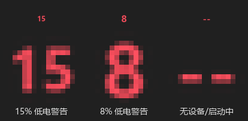

<div align="center">

# batbar

**常驻 Windows 任务栏托盘的多设备电量指示器：鼠标 · 蓝牙耳机 · 机械键盘**

无需罗技 G HUB：HID++ 2.0 + 蓝牙电量属性 + 2.4G 私有协议三路直连，
实时电量以图标 + 百分比常驻任务栏右下角。

[](https://github.com/ClutchBear/batbar/releases/latest)
[](LICENSE)


*图标由程序实时渲染：电量百分比 · 低电变红 · 无设备显示 `--`（上排 = 真实 16px，下排 = 放大）*

</div>

---

## ✨ 核心特性

- 🖱️ **罗技鼠标**：HID++ 2.0 直连（Bolt / Unifying 接收器、蓝牙、有线），支持充电态识别
- 🎧 **蓝牙耳机 / 键盘**：读 Windows 已缓存的蓝牙电量属性（HID++ 唤不醒时兜底）
- ⌨️ **2.4G 机械键盘**（LEOBOG Hi98C Pro / 迈从 K87）：厂商私有协议事件推送 + 周期扫描，USB 有线兜底
- 🔋 **托盘图标实时刷新**：设备主动通知秒级响应，电量百分比一目了然，低电量数字变红警告
- 🌓 **深浅色自适应**：按任务栏深浅自动配色，Win11 托盘菜单跟随系统深色模式
- 🖱️ **RAWINPUT 鼠标唤醒**：纯点击（光标不动）也能唤醒电量读取；设备睡眠自动退避、唤醒后补读
- 🎮 **全屏 / 游戏感知**：进全屏自动暂停轮询，退出约 10 秒恢复，不抢游戏资源
- 📦 **绿色单 exe**：约 9 MB 双击即用，数据落在 exe 旁边，零安装、零外部服务、零驱动
- 🧪 **518 项单元测试**：协议编解码 / 状态机 / 启动链黑盒冒烟全绿（任意机器可跑，无需硬件）

> 🏷️ **名字来历**：原名 `logi-tray`，因管的其实是**三类**设备（含迈从、LEOBOG 等非罗技品牌），
> 2026-10-13 改名 **batbar**（**bat**tery + task**bar**）。改名波及面与数据迁移全程见 **[更新记录.md](更新记录.md)**。

> 📍 **改代码前先看 [`ARCHITECTURE.md`](ARCHITECTURE.md)** —— 模块职责表、功能路由直达表与改代码铁律。
> 本 README 讲选型理由、运行步骤与协议要点；**带日期的开发日志与协议逆向过程在 [`更新记录.md`](更新记录.md)**。

## 🚀 快速开始

**方式一：下载 exe（推荐）** —— 到 [Releases](https://github.com/ClutchBear/batbar/releases/latest)
下载 zip，解压后双击 `batbar.exe`，托盘即出现电量图标；数据/日志就在 exe 旁边。

**方式二：源码运行**（Windows + cmd）：

```bat
git clone https://github.com/ClutchBear/batbar.git
cd batbar
setup-agent.cmd                                      :: 建 .venv，装 hidapi+pystray+Pillow
.venv\Scripts\python.exe -m batbar.agent --probe    :: 协议自检（先点一下鼠标唤醒）
run-agent.cmd                                        :: 前台启动，托盘出现电量图标
```

开机自启、协议排查、打包与 CI 构建见 [§6 运行步骤](#6-运行步骤)。

## 📸 图标预览

| 深色任务栏 | 浅色任务栏 | 低电警告 |
| :---: | :---: | :---: |
|  |  |  |

*由 `tools/render_icon_preview.py` 用项目自身代码渲染生成，改图标后重跑即可刷新。*

## 📚 文档导航

| 想了解 | 去哪 |
|---|---|
| 技术选型理由 / 协议原理 / 架构 | 本文件 §0 ~ §5 |
| 跑起来 / 测试 / 打包 / CI | 本文件 §6 |
| 自测状态与诚实边界 / 已知坑 | 本文件 §7、§8 |
| 改代码（模块职责 / 路由） | [ARCHITECTURE.md](ARCHITECTURE.md) |
| **带日期的开发日志、协议逆向全过程** | **[更新记录.md](更新记录.md)** |

---
## 0. 先看结论

| 维度 | 选型 | 一句话理由 |
|---|---|---|
| 托盘 GUI 框架 | **pystray 0.19.5**（纯标准库 `ctypes` 后端） | 唯一跨平台、专做系统托盘、零 Win32 重型依赖的库；不拖 PyQt/Tkinter 整框架 |
| 图标渲染 | **Pillow 10+**（程序化绘制 PNG） | 电量变化要重画图标，Pillow 画图 + 不依赖外部图片资源，体积可控 |
| 读设备电量 | **cython-hidapi 0.15.0**（PyPI 包名 `hidapi`，import 名 `hid`） | HID++ 2.0 vendor collection 必须直连 HID 设备，hidapi 是唯一干净入口 |
| 电量协议（鼠标） | **HID++ 2.0**（feature `0x1004` 优先，`0x1000/0x1001/0x1F20` 兜底） | 罗技官方私有协议，Solaar 实测；比标准 HID 电量精确、支持充电态 |
| 电量协议（键盘） | **厂商私有 2.4G 通道**（0xFF02 事件推送 / 0xFF04 口）+ USB 有线 | LEOBOG/K87 不实现 HID++，走接收器私有帧；详见 §3.4 与 [④ 系列](更新记录.md) |
| 蓝牙兜底（耳机/键盘） | PowerShell `Get-PnpDeviceProperty` | 设备睡眠时读不到，借 Windows 已缓存的蓝牙电量 |
| 包管理 | **uv**（PEP 621 可选依赖组） | 你指定的工具；`--extra` 组天然隔离各端依赖 |

---

## 1. GUI 框架选型及理由

需求是"系统托盘常驻图标"，不是画窗口。据此筛掉重型框架：

| 候选 | 能否做托盘 | Windows 依赖 | 体积 | 结论 |
|---|---|---|---|---|
| **pystray** | ✅ 专职 | 仅 stdlib `ctypes`（自带 win32 后端） | 极小 | ✅ **选中** |
| PyQt6 / PySide6 | ⚠️ 要 QSystemTrayIcon + QApplication 事件循环 | Qt 全套 ~150 MB | 巨大 | ❌ 为一个托盘图标拖整个 Qt，杀鸡用牛刀 |
| wxPython | ⚠️ 需 wx 框架 | wxWidgets 原生库 | 大 | ❌ 同上 |
| Tkinter | ❌ 无原生托盘 | — | — | ❌ 标准库但没有托盘 API，硬造反而更复杂 |
| 直接 Win32 `Shell_NotifyIcon` | ✅ | 自己写 ctypes 消息循环 | — | ⚠️ pystray 就是它的封装，没必要重造 |
| pywin32 | ✅ | 需 `win32gui` 等编译扩展 | 中 | ❌ pystray 用纯 ctypes，免装 pywin32 |

选 **pystray** 的三条硬理由：

1. **职责单一**：它的唯一功能就是跨平台系统托盘，API 就是 `Icon(name, image, title, menu).run()`，换图是 `icon.icon = <PIL.Image>`、改悬停文字是 `icon.title = "..."`——恰好是本项目需要的两个动作。
2. **Windows 后端零重型依赖**：pystray 的 win32 后端是自带的 `ctypes` 绑定（PyPI 页面 0.17.4 起专门把 `_WinDLL` 导入收敛到库内），不需要 pywin32、不需要 Qt。0.19.5 还修了"屏幕缩放变化后图标变糊"的老 bug，对 2K 高分屏（你的机器 2560×1440）友好。
3. **`run()` 阻塞主线程的消息循环，与我们的 TCP 守护线程天然分工**：pystray 要求托盘消息循环跑在主线程，我们把网络与轮询放后台线程，正好符合。

> ⚠️ pystray 已 3 年没发新版（0.19.5，2023-09-17），但它是**稳定**而非**废弃**——
> 系统托盘 API 本就几十年不变，0.19.5 对 Pillow 10+ 的新 image flags 已适配。

---

## 2. 图标随电量变化的实时刷新机制

三个触发源，按响应优先级从高到低：

```
① 设备主动通知（最快，秒级）
   罗技鼠标省电策略下会【自己】把电池变化作为 HID++ Notification 帧上报；
   2.4G 机械键盘同理（0xFF02 口厂商事件推送）。
   Windows agent 的读循环在等待请求回复的同时顺手消化通知帧
   （session._on_notification），立即更新状态并换图。

② 轮询兜底（60s / 睡眠退避 300s）
   BatteryPoller 默认每 60s 请求一次电量；
   若连续读不到（设备休眠），退避到每 300s 试一次，醒来后回到 60s。
   —— 详见 state.py，纯逻辑、已被单测覆盖。

③ 蓝牙兜底（5min）
   耳机等蓝牙设备睡眠时 HID++ 打不醒，用 PowerShell 读 Windows 已缓存的蓝牙电量。
```

**刷新链路**（数据 → 图像 → 托盘）：

```
BatteryInfo ──► state.take_icon_update()  // 只有"跨 5% 档"或"充电态翻转"才算 dirty
                （86%→85% 不重绘，省 CPU 也省鼠标被频繁唤醒）
        dirty ►│
              icons.render_icon()  →  32×32 PNG（Pillow 程序化绘制）
                                     │  单色跟任务栏：浅色栏黑字 / 深色栏白字
                                     │  （与音量/WiFi 系统图标同款）
                                     │  充电态**不画 ⚡**（图标恒为纯数字；
                                     │  2026-10-12 定稿：LEOBOG/K87 都不显示）
                                     ▼
              agent._set_icon()  →  pystray.Icon.icon = Image.open(png)
                                     pystray.Icon.title = tooltip   // 鼠标悬停显示百分比
```

关键设计：**变化检测放在纯逻辑层**，不是每次轮询都重画图标。
`render_key()` 把百分比归到 5% 档位、连同充电态一起比较，只有档位变了才置 `dirty`。
这样托盘不会每秒闪、也不会因为电量在 85↔86 抖动画一堆无意义的图。

---

## 3. 从罗技设备读取电量的方式

### 3.1 主路径：HID++ 2.0（USB 接收器 / 有线）

**本机实测**：你的机器上罗技设备是 `USB\VID_046D&PID_C53F`——这是 **Bolt 接收器**
（三接口复合设备：MI_00 键盘、MI_01 鼠标、**MI_02 = "符合 HID 标准的供应商定义设备"**）。
电量查询就发给这个 vendor collection（usage_page 0xFF00 系）。**不是蓝牙直连**，
本机没有任何 `BTHENUM` 蓝牙电量属性。所以主路径确定。

查询流程（全部字节布局以 **Solaar 项目源码为准**，见 `hidpp.py` 注释里的行号）：

```
1) 打开 HID 设备
   hid.enumerate() → 挑 vendor_id=0x046D 且 usage_page∈{0xFF00,0xFF40,0xFF41,0xFFB0}
   的那个 collection，open_path + set_nonblocking。

2) 特性发现：把"特性号"翻成"特性索引"
   HID++ 2.0 里每个功能叫一个 feature，用 16-bit 号标识（电池 = 0x1004 等）。
   但设备把 feature 放在一张索引表里，得先问 ROOT feature(索引 0) 的 GetFeature：
     请求: report_id=0x10, devnum=0xFF, request_id=(0<<8|0x00)|sw_id, 参数=[0x10,0x04]
     回复: 数据段第 0 字节 = 该 feature 的索引（本项目记为 featIdx）

3) 读电量（按特性优先级逐个试，命中即停）
   0x1004 UNIFIED_BATTERY  ← 现代鼠标（MX Master/Anywhere 等）主力，function 0x10
     回复 [discharge%, level_byte, status, _]  → 百分比 + 档位 + 充电态
   0x1000 BATTERY_STATUS   ← 早期设备，只给档位（empty/critical/low/good/full）
   0x1001 BATTERY_VOLTAGE  ← 给 mV，用折点表线性插值成百分比（表抄自 Solaar）
   0x1F20 ADC_MEASUREMENT  ← 充电状态机
```

帧结构细节（`hidpp.build_write_frame`）：短帧 `[0x10, devnum] + 5字节data`，
长帧 `[0x11, devnum] + 18字节data`，data = `request_id(2B) + params`，不足补零。
`request_id` 低 4 位是 sw_id，且**恒置 bit3**（`0x08..0x0F`）——这是 Solaar 区分
"我的请求的回复"和"设备主动通知"的约定，本项目严格遵守（见 `is_notification`）。

> 已用 49 个单元测试覆盖以上全部编解码/发现/读电池/错误帧/通知消化逻辑，
> 不需要任何硬件即可跑（`tests/test_hidpp.py`、`test_session.py`）。

### 3.2 第二数据源：蓝牙设备电量（键盘 / 耳机，`bt_battery.py`）

三模键盘（如 LEOBOG Hi98C Pro）的蓝牙通道、蓝牙耳机（如 QCY Era 7）连上
Windows 后，系统蓝牙栈会把电量写进设备节点的 `DEVPKEY_Device_BatteryLevel`。
一次 CIM 查询拿全量（TTL 20s 缓存，PowerShell 子进程 ~300ms）：

```powershell
Get-CimInstance Win32_PnPEntity -Filter "DeviceID LIKE 'BTH%'" | ForEach-Object {
  (Get-PnpDeviceProperty -InstanceId $_.InstanceId -KeyName 'DEVPKEY_Device_BatteryLevel' `
      -ErrorAction SilentlyContinue).Data
}
```

本机实测：电量节点分布在两种前缀——耳机（HFP）电量挂在
`BTHENUM\{...111E...}`（Hands-Free AG 节点），BLE 键盘电量挂在 `BTHLE\DEV_xxx`
节点，枚举器把前缀小写化（`bthle\`），WQL `LIKE` 不区分大小写但
`StartsWith('BTHLE\DEV_')` 这类大小写敏感比较会全漏，判类型前先 `.ToUpper()`。

**自适应过滤（关键）**：Windows 会保留配对过设备的 PnP 节点——键盘从蓝牙切到
2.4G dongle 后，它的 `BTHLE\DEV_xxx` 电量节点仍然 `Present=True`、电量值还挂着。
照单全收就会把"已经不走蓝牙"的设备错误显示。实测判据分两路：

| 设备类型 | 在连判据 | 实测 |
|---|---|---|
| `BTHLE\DEV_`（BLE 键鼠） | 该 MAC 有派生的活跃 HID 节点（HIDClass 里 Present 且 DeviceID 含 `_<MAC>&COL`） | Hi98C 切 2.4G 后派生 HID 消失 → 正确剔除；K87 走蓝牙 → 保留 |
| `BTHENUM\{...111E...}`（经典蓝牙耳机） | 同 MAC 的在连 profile 节点数 ≥ 2（A2DP/AVRCP/HFP 成组才是活动连接） | QCY / 西圣两只耳机保留 |

实测结果：`{'西圣耳机': 70, 'QCY 耳机': 90, '迈从键盘': 100}`——Hi98C 切到 2.4G 后
蓝牙项按预期消失（但会在菜单里以 `(2.4G)` 条目补位，见下）。

**★ 权威连接态过滤（2026-10-12 晚，用户需求「未连接的蓝牙设备不显示」）**：
上面两路判据是**节点存在性**启发式，实测会漏——断连后节点照样驻留。取证过程：

| 候选判据 | 实测结果 | 结论 |
|---|---|---|
| `Present` / `Status` / `ProblemCode` | 四台（含三台未连接）全是 `True` / `OK` / `0` | ❌ 无区分度 |
| `DEVPKEY_Device_DevNodeStatus` | 已连 QCY 与未连 XISEM 的 AG 节点同为 `0x0180600A`；且两次读值还不一样 | ❌ 不稳定 |
| 节点全属性差集 | 未连节点反而属性更多（保留了历史 profile 节点） | ❌ 无判别键 |
| **WinRT `BluetoothDevice.ConnectionStatus`**（classic） | 经典蓝牙（耳机）准：QCY=Connected / XISEM=Disconnected 与设置页一致 | ✅ 采用（判据①） |
| **WinRT `BluetoothLEDevice.ConnectionStatus`**（le） | BLE HID 键盘准：LEOBOG 在连=Connected、离线 BLE=DBA28E=Disconnected | ✅ 采用（判据②，同进程） |

⚠️ **判据②经历两次演进**：
- **2026-10-12 晚（旧）**：判据①对 BLE HID 假阴性（LEOBOG 连着打字时
  classic 报 `False`），当时用「活跃 HID 派生节点」
  （`HIDClass ... Present` 且 DeviceID 含 `_<MAC>&COL`）补证。
- **2026-10-13 13:20（定稿，bug 14）**：hid 补证有两个硬伤——① 要**另起一个
  ~2s 的 CIM 进程**（快判被拖慢）；② 蓝牙 HID 设备**关机后节点 Present
  不及时移除**，把已关机误判成在连 → 「立即刷新」快判失效、退化成等 CIM
  全量查询（~3-4s，用户报「蓝牙关机等三四秒才消失」）。全景枚举实测
  （`probes/probe_bt_all_status.py`）发现 **`BluetoothLEDevice` 的 le API 对
  BLE 连接态既准确又不陈旧**，遂取代 hid 补证：`_PS_CONN` 里 classic 报在连
  就短路，否则补查 le，合并 `classic ∪ le`，**全程同一个 PS 进程零额外开销**。

最终判据 = **① classic ∪ ② le**（同一进程内合并，Python 侧只透传 bool）。

实现：`_PS_CONN` 用 `FromBluetoothAddressAsync(mac)` 逐台查 classic/le 两套
`ConnectionStatus`，必须跑在 **Windows PowerShell 5.1**（PS7 默认无 WinRT 类型
投影）；结果按 MAC 缓存 15s（查询本身 ~0.5s，跟主查询同轮做）。
`_parse(items, connected=...)` 对 `connected[mac] is False` 的行**整条丢弃**；
MAC 不在表里（查询失败/新设备）= 未知 → 保留（fail-open，绝不因连接态查询
挂掉而丢功能）。实测效果：`{'耳机 QCY Era 7': 100}` —— 充电盒里未连接的西圣
耳机不再显示（顺带解决「充电中还在报低电红字」），两只切到 2.4G 的键盘的陈旧
蓝牙读数也一并消失（它们的实时读数由 `(2.4G)` 条目提供）。

#### 三处改动（2026-10-12）：完整覆盖三台设备

**① 电量读不到 ≠ 设备不在连 —— 西圣 XISEM-Air 的隐身案**

旧实现见到电量 NULL 就把整个节点 `return` 掉，于是设备时有时无。真因是
`Get-PnpDeviceProperty` **第一枪常常返回 NULL**，紧接着的第 2 枪才出值：

```
实测：xisem_read_1=NULL  read_2=70  read_3=70  read_4=70  read_5=70
```

修法两条：查询里给每个节点「最多三枪、间隔 200ms」的重试；同时 NULL **不再
丢弃节点**，而是如实返回 `None`，由 `lastknown.py` 补上一次的读数。

**② `lastknown.py` —— 最后已知电量持久化**

`<数据目录>\last-known.json`（打包后 = exe 同目录，见 [更新记录](更新记录.md) §6-J），原子写（先 `.tmp` 再 replace）。
凡是读到真值就落地，供「NULL 轮」和「2.4G 模式」复用，跨进程、跨重启都在。

**③ `receiver24.py` —— 2.4G 接收器的兜底条目**

键盘切到 2.4G 后蓝牙链路彻底没有电量源，此时用 lastknown 里它上一次在蓝牙上
的读数顶上，菜单里标 `(2.4G)`，悬停提示写清「2.4G 上次读数 25 分钟前」——
**明示是旧读数，不冒充实测**。详见 §8 坑 7。

本轮改动让菜单从 2 台变成 **全部 5 台**：

```
罗技鼠标: 90%           LEOBOG 键盘 (2.4G): 93%   西圣耳机: 70%
迈从键盘 K87: 100%          QCY 耳机: 90%
```

### 3.3 多设备切换（参考 FerrisPulse 的产品形态）

托盘右键菜单动态列出所有发现源（每次弹出重新求值，pystray 的
`Menu(callable)` 模式）：

```
☑ 罗技鼠标 90%
  迈从键盘 100%          # K87，当前走蓝牙
  QCY 耳机 90%
  西圣耳机 90%
─────────────
  立即刷新
  退出
```

（LEOBOG Hi98C Pro 切到 2.4G 后蓝牙项自动消失；切回蓝牙自动回来——见 3.2 自适应过滤。）

点选即切换托盘图标跟踪源，图标 tooltip 显示当前设备名。

### 3.4 主动查询 / 有线判定 / 低电量提醒（2026-10-12 增量）

对标 `linzifeng07/device-battery-tray` 与 `MCHOSE-Battery` 后落地的三件事。

**① 主动查询实验（`tools/probe_query.py`）** — 2.4G 通道此前只做到「被动收帧」
（键盘活动时固件自己推 `type=05` 电量帧）。对标项目把迈从 K99 V2 的 2.4G
**主动查询**协议逆了出来（命令帧 `13 4A 01 00 … 5E`，与我们的 3554:FA09
同源），于是值得一试：能不能像 HID++ 那样「问一句答一句」，而不是等设备自己推。
探针用读写双权限打开 `0xFF02` 接口，先 `drain()` 排干旧帧，再逐条候选命令写下去、
收 `--wait` 秒内回帧，命中电量帧即标 ★★，全量落盘 `probe-query-<ts>.md`。
候选帧逐条标注来源（dbt-K99v2 / mcb-mouse 异或校验 / mcb-kbd Z 帧 / 自研镜像 sum8），
**绝不凭记忆加帧**。⚠️ 铁律：每个 HID collection 只有一条输入队列，多句柄互抢帧
——跑探针前**必须先退出托盘**（探针会用 `singleinstance.already_running()` 自检并拒跑，
除非 `--force`）。**实测结论（2026-10-12，三轮扫描）：零回帧，主动查询证否**——
该接收器纯推送式，详见 [更新记录](更新记录.md) §6-E；探针作为实验工具与协议取证手段保留。

**② 有线判定（`receiver24.wired_bases()`）** — 对标项目把 K99 V2 有线形态硬编码成
`258A:010C`。我们**不能抄**：LEOBOG Hi98C Pro 的有线 VID/PID 本机没有实测记录
（验证时键盘走 2.4G 未插线），凭猜写死 = 埋「换固件就不认」的暗雷。改成**厂商动态
枚举**：厂商 VID（从 `dongle.TARGETS` 推导）出现在任何**非接收器 PID** 的 `USB\`
复合设备节点上 = 键盘本体直接插线。每次起 PowerShell ~1s，故加 TTL=15s 缓存。
显示层据此把键盘条目后缀从 `(2.4G)` 换成 `(有线)`。待用户插 USB-C 线实测确认。

**③ 低电量提醒（`lowbattery.py`）** — 抄 MCHOSE-Battery 的产品逻辑并本机加固：
- **去抖**：连续 3 次 ≤阈值(默认 15%) 才弹一次，滤掉链路切换瞬间固件吐的孤立 0 帧；
- **迟滞**：触发后解除布防、静默，直到回升到 `阈值+5`(20%) 才重新布防，防阈值线反复弹；
- **豁免**：充电中 / 有线不弹。**弹前用 `wired_check` 闭包实时复核一次有线态**（force
  绕缓存）——缓存滞后一个周期的代价是「插着线还被弹低电」，属假警报，必须堵死；
- 走 pystray `icon.notify()`（部分后端要回调参数，`TypeError` 双签兜底），零新依赖。
- 接线：`_feed_lowbat` 一律用**剥后缀基名**做 key（同一键盘在 (2.4G)/(有线)/蓝牙名
  间切换时计数与布防态必须连续）；2.4G 电量帧经 `dongle.on_frame` 即时喂（不受 UI 2s
  节流挡），全设备快照经 `_bt_warm_loop` 每轮喂一遍。
- **2026-10-12 晚改版：图标四段式选源 + toast 默认关闭**（用户拍板「启动优先
  显示电量低的耳机；可手动切换；低于 20 的设备长显」；22:32 二次拍板把
  「手动切换 10 秒后自动回退」改为**粘住不回退**——勾了 LEOBOG 十几秒后
  图标自己跳回耳机，跟对勾完全对不上）。
  `agent._icon_target()` 返回 `(显示名, pct, 是否变红)`，规则：
  1. **手动选择粘住**：菜单点某台 → 图标显示它，**直到点另一台或它从快照
     消失**（拔线/断连/关机才临时回落自动规则，它一回来图标立刻跟回去）。
     想恢复旧的「N 秒后自动交还」行为，设 `BATBAR_MANUAL_TTL=<秒>`（由独立
     计时线程交还——`_bt_warm_loop` 一轮 ~9s，比窗口还长，靠它轮询会晚好几秒）；
     点击落地还复用**弹菜单那一刻的同一份快照**（修「菜单行 100、点下去
     图标变 99」：旧实现点击后又异步重读一次，ADC ±2 抖动跨帧）；
  2. **低电长显**：有设备 ≤ 阈值（默认 **20%**，`BATBAR_LOWBAT_THRESHOLD` 可调）
     → 显示其中电量最低的那台并**变红**（深色任务栏 #e74856 / 浅色 #c50f1f，
     取自用户指定的 Windows Terminal 错误红族）；粘住期间低电**也不抢**图标；
  3. 无低电设备 → **优先显示电量最低的耳机**（`lowbattery.pick_preferred`，
     耳机不盯着容易突然没电）；
  4. **终极兜底（23:4x 补，修「只插键盘托盘问号」）**：连耳机都没有 → 显示
     快照里**任意有读数设备中电量最低的一台**（先非有线/充电，纯插线键盘
     才轮到有线本体）；全部读不出才 None。②③的排除是「谁有资格抢图标/
     报警」的规则，不该滑成「明明有设备图标却永远问号」。
  纯函数在 `lowbattery.pick_display / pick_low / pick_preferred`（有线/充电中
  不参与报警层，插着电不是「需要关注」；0%/None 排除——2.4G 毛刺常吐假 0）。
  实测（18:35）：快照 `{西圣 50, QCY 100, K87(2.4G) 90}` → 自动显示 **西圣 50**；
  手动点 QCY → 显示 100 并**一直停着**。想恢复 toast 设 `BATBAR_LOWBAT_TOAST=1`。
- **★ 图标 / 列表 / tooltip 三链同源（23:4x，用户报三连）**：
  1. **全拔掉 tooltip 显示「鼠标 罗技 未知」**——跟踪源那台根本不在快照里，
     `_apply_icon` 的 tgt=None 回落还在拿跟踪源撑门面。修：快照空 → 图标 "?"
     + tooltip **「未发现设备」**；快照有条目但全读不出（关机充电伪 None /
     毛刺 0）→ 如实显示快照第一台的 "?"，**不再回落跟踪源**（那正是
     「托盘显示耳机、列表却没有」的裂缝——图标与列表从此严格同一份快照）；
  2. **只插键盘 + 立即刷新，列表有了、托盘还是问号**——键盘是有线/充电态，
     被报警层排除后选源直接 None。修：上面第 4 条兜底；
  3. **耳机刚连上列表里没有**——蓝牙源 20s TTL + 连接态 15s 缓存（WinRT 对
     刚连上的设备可能还报 Disconnected）。修：`BluetoothBattery.force_refresh()`
     同步强刷 + 连接态强制重查，「立即刷新」改调它（原来只 `prewarm()`，
     TTL 内是空操作）。
  新增 8 项测试：`IconTarget` 兜底 3 项、`IconApplyNoDevices` 3 项、
  `ManualRefreshForcesBT`、`ForceRefresh` 2 项中除重复合并后计入。
- **罗技条目在/离线（2026-10-12 参考 [OpenLogi](https://github.com/AprilNEA/OpenLogi)
  「不应答 = 不在」，用户报「鼠标关机/USB 拔掉仍显示电量」）**：旧实现
  `_last_info` 一旦读到就永久挂快照——鼠标关了、接收器拔了，那条 90% 纹丝不动。
  新增 `agent._probe_mouse()`：`_bt_warm_loop` 每轮（~9s）调用，读数超过
  `MOUSE_FRESH`（20s）没更新就 `read_battery()` 当场探一次——有应答刷新缓存；
  不应答/枚举不到/句柄失效（拔线典型抛 `TransportClosed`）→ **清掉 `_last_info`**，
  条目从菜单与图标消失，统一 30s 退避（`_sleep_until`，与 `_tracked_read` 共用）。
  ⚠️ 不能用 `ping` 当判据：G304 这类 Unifying 设备对空口 ping 不回帧，
  `read_battery` 才是可靠探针（请求本身会顺带唤醒设备）。鼠标重新开机/接收器
  重新插上后下一轮探测自动复活，无需重启托盘。「立即刷新」同口径（不应答就消失）。
- **★ 插回接收器后不复活（2026-10-12 实测：拔掉能消失，插上刷新多次都不出现）**：
  上面只解决了「消失」，复活还卡在三处，逐条修：
  1. **会话冻死在 0xFF**：`_discover_devnum` 扫 1-7 槽位时 `retries=0`，
     而**插上那一刻鼠标多半在睡，第一枪只负责唤醒、回帧赶不上 0.4s 窗口**
     → 全扫落空 → 回落 `0xFF`（接收器本体，**没有电池特性**，`read_battery`
     永远 None）→ 日志刷 `device_index=255` + 无限 `no known battery feature`。
     修法：每槽给**唤醒预算**（`timeout=0.8/retries=1`，两枪覆盖「唤醒+命中」），
     并**记住上次扫中的槽位** `_last_devnum` 走快路径（对码号稳定，重建时
     只戳一个槽）。
  2. **死会话不丢**：`_probe_mouse` 拿到 None 就退避，却**保留了 0xFF 会话**，
     `_ensure_device` 下轮直接返缓存 → 永远读不出。修法：读不到且
     `sess._devnum == DEV_RECEIVER` → **丢会话**强制下轮重扫（真槽位会话
     不应答 = 鼠标确实关机，会话要留着复用句柄）。
  3. **丢了不重建**：`_push_fresh_read` 原只 `_drop_device()` 就返回——
     **丢会话只是把门打开，不重建等于没修**，用户点十次刷新只是丢了十个死会话。
     修法：丢完**当场 `_ensure_device()` 重建并重读**，且清零 `_sleep_until`
     （别让后台探测还卡在 30s 退避里）。
  真机验证（`probes/verify_mouse_revive.py`）：`USB Receiver` 扫中槽位 **1**，
  `read_battery` → **90%**，复活链路通。
- **★ 蓝牙缓存空结果翻烙饼（2026-10-13 00:05 用户报：图标显示 99、菜单却
  「未发现设备」；LEOBOG 蓝牙跟踪 18s 后被误判离线回落 hidpp；列表忽有忽无）**：
  三份报告同一个病根——`_run_query` 对**空查询结果无条件清缓存**，而 WMI/WinRT
  查询间歇性抽风（实测连着的 LEOBOG/QCY 上一轮还在、下一轮整表空）。菜单与
  图标在不同时刻各读一次缓存，撞上空表/满表各不相同 → 劈成两个世界。
  修法：`_accept()` 空结果**保留旧列表**；非空结果照常落盘。
  真机复测（`probes/probe_bt_now.py`）：同一时刻蓝牙链路返回
  `{QCY 90 已连, LEOBOG 99 已连}`，链路本身健康，坐实是间歇性空表而非设备问题。
- **★★ 上面那条的判据修错了：必须按时间，不能按次数（2026-10-13 01:18 用户
  复报「设备全关、只连 LEOBOG 蓝牙，托盘有电量、列表仍没有」）**：初版判据是
  「连续 `EMPTY_LIMIT=3` 次空」并注释成 ≈60s —— 但**空结果返回极快**（不带
  重试），实测日志 `01:18:27 / :31 / :34` 三次空**只花 7 秒**就满足判据 →
  缓存被清 → 菜单「未发现设备」；同时那次图标更新又撞上 `WinError 1402`
  （见下一条），图标**保留旧数字** ⇒ 「托盘有、列表没有」。
  改为 `EMPTY_GRACE=180s` 时间窗：距上次**成功查询**不足 180s 就一律保留旧
  列表，超过才接受「设备真离线」。
- **★ 图标更新必须串行化（同一次实测里的 `seticon failed: [WinError 1402]
  无效的光标句柄`）**：pystray 的 `icon` setter 内部是「先 `_release_icon()`
  销毁旧句柄、再 `_assert_icon_handle()` 建新句柄」，而图标有 4 个更新来源
  线程（`_bt_warm_loop` 每轮 / `_refresh_from_tracked` / dongle 帧回调 /
  `_manual_refresh`）—— 交叉就会 1402。**更新失败时图标保留上一次的数字**，
  这正是「图标与列表劈叉」的另一半原因。修法：`Agent._icon_lock`（RLock，
  因为 `_menu_items` → `_apply_icon` → `_set_icon` 是同线程的一条链，必须
  可重入）包住句柄替换。
- **★ 图标永不显示 `?`：读不出电量一律 `--`（2026-10-13 用户定稿）**：
  用户原话「**启动就显示两个减号，任何时候都不能显示问号**」。
  ① 像素层：`icons._text_for()` 对 `percent is None` 恒返回 `--`（原先按
  `no_devices` 分 `--`/`?` 两种）；`no_devices` 退化为**纯语义标记**，只影响
  tooltip（「启动中…」/「未发现设备」）与 `key()`。菜单行的「`?%`」同步改成
  「`--%`」，`state.tooltip()` 的 `or '?'` 也改 `or '--'`。
  ② 根因（同一个报障里挖出来的**幽灵鼠标条目**）：`_last_info` 允许持有
  **percent=None** 的 BatteryInfo（接收器在、鼠标关着；或刚上电那一瞬），
  于是 `devices_snapshot()` 造出 `{"鼠标 罗技 G304": None}` —— 菜单多一行
  「鼠标 罗技 G304 ?%」、图标落到「有条目但全读不出」分支画 `?`，
  **设备根本没连却像在**。三处设防：`devices_snapshot()` 只收 percent 非 None
  的鼠标读数、`_tracked_read()` 不把 percent=None 的 info 写进 `_last_info`
  （按 sleeping 处理）、`_on_notify()` 同理（消息照常转发）。
- **★★ tooltip 出现「鼠标 罗技 G304：未知」的真凶：`_standalone_loop` 自己
  拼 tooltip（2026-10-13 01:44 用户报「图标已经是 `--`，但触摸板移上去显示
  鼠标 罗技 G304: 未知，过会儿才变未发现设备」）**：`--standalone`（也就是
  重启脚本跑的模式）有**两条**绘制路径 —— `_bt_warm_loop`（~9s 一轮，走
  `_apply_icon`，tooltip 正确）和 `_standalone_loop`（**0.5s 一轮**，旧实现
  自己 `_tip_for(st.percent, charging)` **不传 name**）。而 `_tip_for` 的
  name 默认值是**跟踪源名**（"鼠标 罗技 G304"）⇒ 一台设备都没连时，这条
  高频路径持续把 tooltip 写成「鼠标 罗技 G304：未知」，盖住 `_apply_icon`
  写的「启动中…」，直到 `_bt_warm_loop` 下一轮（`_ready` 后）才纠正成
  「未发现设备」。修法：`_standalone_loop` 的绘制**并入 `_apply_icon`**
  （选源规则 + tooltip 文案单一来源），`icons` 别名随之不再需要。
  契约测试两条：`_standalone_loop` 必须委托 `_apply_icon`（mock poller
  跑一轮断言）、`agent.py` 里 `self._tip_for(` 的调用点**恒为 2**（都在
  `_apply_icon` 内，防止别处再拼出设备名）。
- **★★ 鼠标「睡眠」被当成「离线」：图标有 90%、右键菜单却「未发现设备」
  （2026-10-13 01:52 用户报）**：`_probe_mouse` 只要 `read_battery()` 不应答
  就 `_last_info = None`，可 G304 这类省电鼠标**不动就睡**，一睡就被判离线
  ⇒ 菜单读到空快照 = 「未发现设备」，而图标保留旧数字（选不出目标时旧实现
  不重绘）——又一对劈叉。修法两条：
  ① **按会话形态区分睡眠与离线**：`sess._devnum == DEV_RECEIVER`（0xFF 回落
  = 扫不到任何对码设备）才是真离线 → 清 `_last_info` + 丢会话重扫；**真槽位
  会话但不应答 = 睡眠** → 保留旧读数（`_push_fresh_read` 同口径，否则
  「立即刷新」会把还在的设备刷没）。鼠标关电源时槽位会扫不到 → 仍会消失，
  所以早先「关机不显示」的需求不受影响。
  ② **图标在选不出目标时必须重绘**（`_bt_warm_loop` 的 stale 判据补
  `tgt is None` 分支）——设备真全没了就把图标打回 `--`，不许留着上一台的数字。
  另加诊断日志：`菜单快照：{...}`（每次弹菜单**恰好一行**）+ `罗技条目出现/隐藏`
  状态变化行——这两处过去是黑盒，正是「图标有、列表没有」类问题唯一的现场。
  > 「恰好一行」是 2026-10-14 修出来的：曾一度**每次弹出成两行**，一开始怀疑
  > 右键钩子被注册了两遍，真相在 pystray —— `Menu.items` 是 property，**每次
  > 访问都重跑工厂**，而 `_win32._create_menu()` 一次构建要访问两回（`if not
  > descriptors` + `enumerate`）。代价远不止日志重复：每次右键都白跑一遍
  > `devices_snapshot()`（~3s CIM 查询）。修法是钩子自己求值一次，交给 pystray
  > 的是**具体 tuple**。详见 §B `MenuBuiltOncePerPopup` 的用例与
  > `_install_menu_refresh` 的 docstring。
- **★★ 关机后条目不消失（两轮迭代，最终判据 2026-10-13 11:00 定稿）**：
  02:00 用户报「关电源 5s 后托盘仍显示 90%」后先试了接收器寄存器 0x02
  「Connection State」监看方案（`connection_state()` + `_receiver_watch_loop`
  每 1.5s 轮询已连接数），但**实测证伪**：Bolt C53F 上鼠标关机后该寄存器
  **不掉**（日志里从来没有 `1 → 0`，它更像「对码/挂接数」），方案整体移除。
  同时 `probes/probe_sleep_deep.py` 实测推翻了「不应答 = 睡眠」：**静置 40s 的
  G304 依然在 0.20s 内应答**（空闲 ≠ 不应答，HID++ 请求本身就能叫醒它）。
  最终判据 = **`read_battery()` 连续两次不应答 = 不在**（关机/离队/走远），
  内置一次复读挡单次毛刺（`agent._read_with_second_chance`）；真槽位会话
  隐藏条目但保留（设备回来原会话直接用），0xFF 回落会话照旧丢会话重扫。
  「立即刷新」同口径（`_push_fresh_read`）——11:06 用户报「关机后点刷新
  鼠标还在、还能勾选」正是旧「睡眠保留」口径漏掉的，修后当场消失。
  协议细节仍保留价值：寄存器请求第二字节就是寄存器号
  （`10 FF 81 02 00 00 00`），不能过 `_request` 的 sw_id 掩码，故
  `read_register()` 作为底层原语留在 session.py。
  **✅ 11:34 用户实测三场景通过**：① 关鼠标电源不点刷新，条目自动消失
  （后台探测 ~9s 一轮 + 30s 退避）；② 拔接收器点「立即刷新」当场消失
  （枚举不到 = 清条目）；③ 插回再拔掉约 1 分钟消失（读数 8s 保鲜期过后
  两次不应答）。
- **★ bug 12：关掉最后一台蓝牙设备，条目永不消失（2026-10-13 11:41 用户报，
  两场景对称：先关耳机→键盘杀不掉 / 先关键盘→耳机杀不掉）**：蓝牙条目靠
  CIM 查询刷新——还剩 ≥1 台设备时关掉一台，查询仍返回非空表，当轮就更新
  （4-5s 消失 ✓）；关掉**最后一台**，其 PnP 节点整表消失 → CIM 返回空表 →
  掉进 `EMPTY_GRACE=180s` 防抖宽限（空表无法自证「真离线」还是「查询抖动」，
  01:18 那轮修「列表忽有忽无」加的），「立即刷新」也被宽限拦住 → 卡满 3 分钟。
  修法 = **宽限期内 WinRT 权威复核**（`_all_offline_confirmed`）：拿上次成功
  查询攒下的「友好名 → MAC」映射（`_mac_by_name`，新增）反查 WinRT 连接态
  （`connected_macs(force=True)`，不吃 15s 缓存），**全部确认离线 → 立即接受
  空表**；问不出（失败=未知）或仍有在连（=空表必是抖动）→ 维持宽限，
  抖动防护一点不丢。现场取证 `probes/probe_bt_last_device.py`：键盘关机后
  `_PS_QUERY` 整表空、WinRT 对其 MAC 如实报 false。测试 +6（含端到端），
  348 项全绿。
- **★ bug 13 = 手动/自动下线节奏定稿（2026-10-13 12:30 用户需求）**：
  三类设备关机/拔出（鼠标电源 / 2.4G USB / 键盘蓝牙或 2.4G / 耳机蓝牙）
  自动**一分钟左右**消失、托盘切到在线设备；点「立即刷新」要**立刻**消失。
  自动侧：蓝牙 ~30s（CIM TTL 20s + warm loop 9s）、鼠标 ~9-17s（探测循环）
  原本就达标；**2.4G 扫描间隔 300s→60s**（原 5 分钟，关机键盘要等满 5 分钟
  才被扫到不在；扫描本身是 HID 帧查询 ~1.5s/设备，60s 节奏无压力）。
  手动侧（原串行 ~7s）：① 蓝牙离线摘除**前置**——新增
  `drop_disconnected_now()`，WinRT 连接态（~1.5s）确认离线立即摘条目
  （当时靠「hid 活跃节点表 6s TTL 缓存 + 惰性触发」提速，**该 hid 补证后由
  bug 14 移除**，改由 classic∪le 双 API 同进程判定，快判降到 ~0.6s）；
  ② CIM 电量全量刷新改**单枪快查**（`_PS_QUERY` 的重试枪数参数化，
  quick=True 跳过 200ms 重试，在线设备首枪基本有值，NULL 由 lastknown
  兜底），放摘除之后收尾；③ `_manual_refresh` 三路并行（鼠标直读 →
  蓝牙快判 ∥ 2.4G 扫描），新增 `_repaint()`（= `_apply_icon(None, False)`
  全量重算选源，`_set_icon` 有锁线程安全），**每步完成立即重绘**——
  「摘一个、画一个」，不再等全部查询结束才换图。点刷新到条目消失
  ~1.5-2.5s（PS 进程启动是物理下限，0 秒做不到）。测试 +10
  （348→358 全绿）。
- **★★ bug 14：蓝牙关机后「立即刷新」仍等三四秒（2026-10-13 13:14 用户报，
  对比 2.4G「立马消失」）**：根因不是蓝牙协议限制，是**我们自己的 hid 补证
  逻辑**拖后腿。全景枚举取证（`probes/probe_bt_all_status.py`，四台配对设备
  对比 classic/le/hid 三源）钉死：① `connected_macs` 只要**任一**设备报 False
  就触发 hid 补证——**另起一个 ~2s 的 CIM 进程**（`Win32_PnPEntity PNPClass=
  HIDClass ... Present`），耳机（经典蓝牙，WinRT classic 0.5s 就能准确报离线）
  被这个补证连累 → 1.5s+2s≈3.5s；② 更糟的是蓝牙 HID 设备**关机后 Windows 不
  立刻移除其 HID 派生节点**（Present 仍 True 一段时间）→ 补证把「已关机」误翻
  成「在连」，快判 `drop_disconnected_now` 对 BLE 键盘**彻底失效**，只能退化成
  等 CIM 全量查询靠行数消失兜底（~3-4s）。**修法**：hid 补证整体删除，改用
  `BluetoothLEDevice.ConnectionStatus`（le API）——实测它对 BLE 连接态既准确
  （LEOBOG 在连=True）又不陈旧（离线 BLE 设备 DBA28E=False），且能与 classic
  塞进**同一个 PS 进程**（classic 报在连就短路，零额外 spawn）。合并判据
  `classic ∪ le`，Python 侧只透传 bool。真机实测 `connected_macs` 从 ~3.5s
  降到 **0.57s**，且经典耳机 + BLE 键盘都准确。测试：删 4 项 hid 旧测试
  （HidLiveCache 3 项 + ConnJudge 的 hid mock 1 项）、改 3 项、+2 项新判据，
  356 项全绿。删掉的死代码：`_PS_HIDMACS` / `_hid_cache` / `_HID_TTL` /
  `hid_live_macs()` 及 `_run_query` 里的预热线程。
- **★★ bug 15：蓝牙设备重新上线后「立即刷新」仍等三四秒才出现（2026-10-13
  14:36 用户报，bug 14 的对称面）**：下线已能秒消失，但**上线**只有慢路径——
  `force_refresh` 走 CIM 全量查询（实测 4.18s）才发现新设备；快判
  `drop_disconnected_now` 只遍历 `_devices`（已在列表的）做摘除，刚上线的
  设备还不在列表里，够不着。**修法**：新增 `sync_now()`——**一次** WinRT
  连接态查询（classic ∪ le，~0.6s）同时处理上下线两个方向：对 `_mac_by_name`
  （友好名 → MAC，**只增不减**，设备断开后映射仍在）里的全部 MAC 批量问连接态，
  逐台和解：在列表 + 报离线 → 摘除；不在列表 + 报在连 → 加入（电量先用
  lastknown 历史值兜底，真值随后 CIM 刷新）；未知 → 不动（fail-open）。
  ⚠️ **不能拆成 add + drop 两次调用**（会各 spawn 一次 ~0.6s，把 bug 14 刚
  验收的下线时延翻倍），必须合并成单次查询。
  **闪回保护**（`_FAST_ADD_PROTECT=25s`）：快判秒加的设备，紧随其后的 CIM
  这轮**可能还没扫到它的行**（PnP 节点建立滞后于 WinRT 连接态），`_accept`
  的整体替换会把它抹掉 → 用户看到「闪现又消失」。保护期内 CIM 没扫到就沿用
  快判兜底值（`_preserve_fast_adds`）；CIM 扫到真实行 → 保护自动失效以 CIM
  为准；保护期过 → 移除标记交常规逻辑。真机实测（`probes/probe_sync_now.py`）：
  初始 CIM 4.18s vs `sync_now` **0.68s** 秒判上线，提速 6 倍；离线的西圣耳机
  没被误加（只在明确报在连时才加）。测试 +11（`SyncNow` 7 项 + `PreserveFastAdds`
  4 项），356→447 全绿。局限：app 重启后 `_mac_by_name` 为空（纯内存），
  **首次**开机连接的设备走不了快判、仍靠 CIM 发现（~2-4s）；一旦查询跑过一次
- **★★ bug 16：设备拔插 / explorer 重启不再靠轮询猜——`WM_DEVICECHANGE` +
  `WM_TASKBARCREATED` 事件驱动（2026-10-13 18:20 用户实测四组操作，四项全中）**：
  此前「拔接收器/关鼠标 → 托盘条目消失」全部依赖**定时轮询**（鼠标 ~9s / 蓝牙
  ~30s / 2.4G 60s），即使点了「立即刷新」也只是**主动去问**，最快也要一个查询
  往返（蓝牙 0.68s、CIM 4s+）；**拔线这种纯硬件事件没有任何东西在监听**。
  改法：在既有的隐藏消息窗口（`_start_theme_watch` 那个，本来就为
  `WM_DWMCOLORIZATIONCOLORCHANGED` 建的）里补三个分支：

  | 消息 | 触发场景 | 动作 |
  |---|---|---|
  | `WM_DEVICECHANGE`(0x0219) | 拔插 USB / 设备树变动 | 去抖计时，静默后 `_refresh_from_tracked()` |
  | `WM_TASKBARCREATED` | explorer 崩溃/重启后重建任务栏 | 重新 NIM_ADD（`icon.visible = False → True`） |
  | `WM_TIMER`(0x0113) | 去抖到期 | 真正触发刷新 |

  ⚠️ **必须去抖**：一次插拔实测产生 **12 条** `DBT_DEVNODES_CHANGED`
  （`probes/probe_device_events2.py` 四窗口对照，含 `DBT_DEVICEARRIVAL`
  0x8000 / `DBT_DEVICEREMOVECOMPLETE` 0x8004 / `DBT_DEVNODES_CHANGED`
  0x0007），逐条刷新会打爆 HID 队列。去抖用 Win32 `SetTimer`（600ms 静默期
  `DEBOUNCE_SECONDS=0.6`），**不是线程 sleep** —— sleep 会占着消息窗口线程
  且与消息循环竞态。到期后 `KillTimer` 再起后台守护线程跑刷新。
  ⚠️ **`RegisterDeviceNotification` 其实不必要**：`WM_DEVICECHANGE` 是
  **广播**消息，实测四种窗口样式（隐藏 POPUP / 可见 OVERLAPPED / POPUP+工具窗
  / `WS_EX_TOOLWINDOW`）**全部能收到**，普通隐藏窗口即可，不用注册设备接口通知。
  ⚠️ **`WM_TASKBARCREATED` 不是常量**：它是
  `RegisterWindowMessageW("TaskbarCreated")` 的**动态注册号**（本机实测
  = **0xC0BE**），必须运行时取，硬编码别的机器会不生效。
  ⚠️ **explorer 重启后必须重发 NIM_ADD**：旧句柄随旧任务栏一起没了，
  光 `NIM_MODIFY` 不会让图标回来。

  **真机四条事件全中（2026-10-13 18:22-18:23，用户配合四组操作）**：

  ```
  18:22:59.412  设备树变化（debounced）→ 触发即时刷新（第 1 次）   ← 拔 USB
  18:23:01.099  扫描完成：{}
  18:23:04.327  设备树变化（debounced）→ 触发即时刷新（第 2 次）   ← 插回 USB
  18:23:16.632  任务栏已重建（explorer 重启）→ 重建托盘图标
  18:23:16.904  托盘图标已在新任务栏重建（NIM_ADD）    ← 272ms
  18:23:29.304  opened HID++ device: up=0xFF00 USB Receiver
  18:23:29.495  罗技条目出现：90%
  ```

  去抖效果：一次插拔的 12 条 `DBT_DEVNODES_CHANGED` 只产生 **1 条** debounced
  日志。测试 +15（`tests/test_winevents.py`：Debouncer 语义 5 + classify 2 +
  Agent 回调 5 + WndProc 分发契约 4 + 回调注册表 2）。随后 **RAWINPUT 鼠标唤醒**
  （同日，见 §H）再加 14 项（`RawInputDecode` 9 + `BootOrderDarkMenus` 2 +
  `MouseActivityGate` 3）；**全屏/游戏感知**（同日，见 §I）再加 49 项
  （`test_fullscreen.py` 37 + `test_lowbattery.py::GateSuppression` 8 +
  `test_poll24.py::SkipWhenGate` 4），**367 → 447 全绿**。
- **★ 启动首帧（2026-10-13 00:31 用户报：启动 5 秒空白 → 画 `?` → 约 10 秒后才
  `--`）**：两处各修一次。① `_build_tray` 建托盘时用的是**全透明空图**，真正的
  第一帧要等后台读完蓝牙（首次 CIM 查询实测 4~25s）⇒ 新增 `_paint_boot()`，
  建托盘这一步**同步**画 `--` + tooltip「启动中…」，不读硬件、不等查询，托盘
  一出现就有内容（用户要的就是「证明它启动了」）。② 空白之后的 `?` 来自
  「幽灵条目读不出值」（快照有条目但全是 None）⇒ 新增 `_ready` 闸门：**拿到过
  任何真读数之前一律 `--`**，置位点是 `_apply_icon`（快照出现非 None）与
  `_bt_warm_loop`（第一轮采集跑完，之后空表才说「未发现设备」而不是一直挂
  「启动中…」）。③ 顺带加速：跟踪源已有读数时，首帧用「只含它一台」的快照
  立刻画（`_refresh_from_tracked`），不排队等蓝牙全量查询——鼠标电量 1 秒就有，
  不该陪蓝牙一起等；用户已手动选源时不走这条快路径。
- **★「启动中…」只挂一个鼠标时挂 ~20s，多设备时几乎看不到（2026-10-13 09:38
  用户报）**：不是采集慢——实测空槽位探测只要 **0.03s**（接收器对未对码槽位
  直接回错误帧，`probes/probe_boot_cost.py`），首轮真正的大头是首次蓝牙 CIM
  查询（`cached_devices()` 阻塞 ~5s，`prewarm()` 本身是异步的）。真凶是
  **首轮跑完没人重绘**：`stale` 判据比的是**图标数字**，而启动占位图本来就是
  `--`（percent=None）⇒ 空快照下 `stale` 恒 False，`tgt` 与 `_last_warn`
  又都是 None，于是重绘只能等 `_ticks % 4 == 0` 那一次（每轮 ~5s，约 20s）。
  多设备时 poller 那条 0.5s 循环顺手重绘，把这个缺口盖住了；只挂鼠标时它
  没内容可推，缺口才暴露。修法：`was_boot`（`_ready` 翻转那一轮）显式带上
  重绘条件——「启动中…」→「未发现设备」是**文案**变化，不在 stale 判据里。
  首轮 ≈ 5~7s（蓝牙查询）后文案即归位。
- **★「双击后五六秒才看到图标」的真凶是重启脚本，不是 agent（2026-10-13
  00:40 复现）**：进程内启动实测只要 **0.2 秒**（`probes/probe_boot_timing.py`：
  import 全部依赖 0.10s、首帧渲染 0.03s、`Agent()` 0.00s）。耗时全在 Python
  之外——`restart-diag.bat` / `restart-dpi.bat` 的**第一步**是
  `powershell Get-CimInstance Win32_Process`（带 CommandLine 的全进程 WMI
  枚举），实测 **3~8 秒**，脚本自己都写着 "Wait ~3s"。改法：
  ① `singleinstance.write_pid()` 让 agent 把 PID 写到
  `<数据目录>\agent.pid`（打包后 = exe 同目录），脚本直接 `tasklist /FI "PID eq N"`
  确认是 python 后 `taskkill /F /PID`（几十毫秒）；PID 文件**缺失或指向非
  python 进程**（陈旧文件 / PID 被复用）一律回退到 `Get-Process` 扫描
  （比 CIM 快一个量级）——**漏杀旧实例会让新实例被单实例互斥量挡下**，
  表现成「点了重启没反应」，比多花一秒严重得多。② `run()` 里把 `_build_tray()` 提到最前
  （NIM_ADD 尽早发出，不再排在 3 个后台线程 + 4 个通道 start 之后）。
  ③ 启动各阶段打 INFO 计时点（`_boot()`，日志里 `boot: 托盘首帧已请求 +0.21s`
  这种），下次再慢就能一眼分清是**进程慢**还是 **explorer 显示慢**。
  ④ `scripts/agent-hidden.vbs` 写死了已不存在的 `.venv-win`，双击毫无反应
  ⇒ 改成 `.venv` 优先、`.venv-win` 兜底、再退 PATH 上的 `pythonw`。
- **★★ 更根本的真凶：菜单在图标注册**之前**就同步构建了（2026-10-13 01:14
  真机坐实）**：pystray `Icon.run()` 的顺序是
  `_create_window()` → `_mark_ready()` → **`update_menu()`** →
  （队列通知 setup 线程）→ `visible = True` → `_show()`（NIM_ADD）。
  菜单回调会走 `devices_snapshot()`（蓝牙 CIM 查询 4~25s + USB 枚举），
  于是**图标被整条菜单链卡在最后**——这才是「双击后 5~10 秒才看到图标、
  且一出现就是数字」的主因（bat 的 CIM 扫描是第二个）。
  修法：`_menu_items()` 在 `not self._ready` 时返回**静态清单**
  （「启动中… / 立即刷新 / 退出」，毫秒级、零硬件读取）；`_ready` 置位后
  由 `_menu_ready()` 延迟 0.1s 异步 `update_menu()` 换成真实清单（延迟是
  为了避开「菜单构建中调 `_apply_icon` → 递归回菜单构建」）。
  修复后真机 boot 打点（`probes/relaunch_agent.py` 实测）：

  ```
  +0.03s 日志就绪      +0.09s 托盘首帧已请求   +0.10s 后台通道就绪
  +0.24s 图标已注册（NIM_ADD）   ← 修复前这里要等 5~10 秒
  +0.69s 首个真读数已画
  ```

  `run(setup=...)` 里显式 `icon.visible = True` 并打点，专门标记 NIM_ADD
  时刻：**它之后的时间就都是任务栏（explorer / Seelen UI）自己的显示延迟**，
  与 agent 无关。两个重启 bat 也加了 `%TIME%` 时间戳（script start /
  kill step done / agent launched），和日志的 boot 行一对齐，就能一眼分清
  慢在脚本、慢在进程、还是慢在任务栏。
- **★★ add 之后的第一次 NIM_MODIFY 会被 shell「收下但不重绘」（2026-10-13 09:49
  用户报「只有鼠标时 6~7 秒才显示电量，之前不到 1 秒」）**：agent 日志明明写着
  `首个真读数已画 +0.57s`，用户却 6~7 秒后才看到数字。实测（`probes/
  probe_tray_modify.py`，直接抓 `Shell_NotifyIcon` 的返回值）：

  ```
  +0.33s NIM_MODIFY 返回=0 err=E_FAIL   ← add 之前发 modify，必然失败
  +0.34s NIM_ADD    返回=1
  +0.70s NIM_MODIFY 返回=1 err=0        ← 收下了
  ```

  返回值全是 1 ⇒ **不是被拒收，而是收下后不重绘**：托盘画面停在 add 那一帧
  （用户看到的 `--` + 「启动中…」），直到下一次刷新才换（实测 ~6s，正好是
  `_bt_warm_loop` 那轮）。而 **add 本身必然被渲染**（首帧 `--` 秒出即证据）。
  修法：`_set_icon` 在**内容变化**时改成「重新注册」——`icon.visible = False`
  （NIM_DELETE）+ `= True`（NIM_ADD），让变化走 add 路径；`try/finally` 保证
  异常时图标一定回到可见态（绝不能把用户托盘图标弄没）。内容没变（每 ~36s 的
  定期自愈那一枪）仍走普通 modify，行为不变。
  ⚠️ 上面「NIM_ADD 之后的时间就都是任务栏自己的显示延迟、与 agent 无关」这句
  由此**订正**：add 之后的首帧刷新仍在 agent 可控范围内，得用 add 路径推。
- **★ 启动内容「晚 6~7 秒才出现」的两条修法（2026-10-13 10:05 用户第三次报）**：
  日志明明 `首个真读数已画 +0.68s`，用户仍说 6~7 秒 —— 于是改成**让 NIM_ADD
  那一帧就带上真内容**（add 必然被渲染，modify 不一定，见上条）：
  ① `run()` 里注册图标前先 `_wait_first_paint(BOOT_SHOW_WAIT=1.2s)` 等 `_ready`
  置位；拿到读数就带着电量注册（鼠标在场 → 图标一出现就是 90，**不再有 `--`
  阶段**），拿不到（鼠标在睡/没设备）就照旧注册 `--` +「启动中…」。
  `_setup` 的 boot 行同时记下**注册那一刻的内容与等待时长**：
  `图标已注册（NIM_ADD）内容='启动中…' 等待=1.20s` —— 日志从此能直接回答
  「add 那一帧画的是不是电量」。
  ② 无设备场景首轮实测 **12.14s**，分解＝蓝牙 CIM **5.2s** + `receiver24.
  wired_bases()` 里那条 PowerShell 全量 USB 枚举 **7.1s**（原注释写的 0.5~1s
  是错的）。后者改成**默认非阻塞**：缓存过期就起后台线程去刷，本次返回上一次
  结果（首次为空集）；`force=True`（低电告警前）仍同步扫 —— 那个场景不能拿旧值。
  实测首轮 **12.14s → 5.38s**，顺带治好「第一次右键菜单要等十几秒」。
- **★★ 首次菜单构建必须排在 NIM_ADD 之后（2026-10-13 10:25 用户报「双击后
  没有两个减号了，四五秒后直接出现电量数字」）**：日志给出的证据是
  `boot: 图标已注册（NIM_ADD）内容='耳机 QCY Era 7: 100%' 等待=0.61s +3.63s`
  —— 等待只花了 0.61s，注册却在 +3.63s，中间 3 秒是**菜单构建读了硬件**
  （`菜单快照：` 那几行正好在 +3.5s）。根因：pystray 的 `run()` 顺序是
  「建窗口 → **建菜单** → setup(`visible=True`) → NIM_ADD」，而上一轮的
  「等首帧」把 `_ready` 提前置位了 ⇒ `_menu_items()` 的启动门控（原本只看
  `_ready`）放行，于是**首次建菜单**去读了 `devices_snapshot()`（首次实测
  ~3s）→ NIM_ADD 被拖后 3 秒。修法：新增 `_tray_shown`（`_setup` 里置位），
  菜单门控改成 `not (self._ready and self._tray_shown)` → 静态清单；
  `_menu_ready()`（换真实清单）同样等 `_tray_shown`，托盘注册后由 `_setup`
  再叫一次。实测（`probes/` 观测 + 日志）：**NIM_ADD +3.63s → +0.53s，且
  内容=`鼠标 罗技 G304: 90%`** —— 图标一出现就是电量。
- **★★ 菜单内容只在 `update_menu()` 时才变：右键弹的是**上一次**建好的 HMENU
  （2026-10-13 10:40 用户报「无设备启动 → 10s 后开鼠标 → 托盘有电量，右键菜单
  却还是『启动中…』」）**：pystray 的右键是 `_win32.Icon._on_notify` → 直接
  `TrackPopupMenuEx(self._menu_handle)`，**不重建**。所以启动那次静态构建会一直
  生效，必须有人在弹出前换掉它。上一轮我在 `_setup` 里调 `_menu_ready()` 时
  `_ready` 还是 False，把「一次性换清单」的名额提前消耗掉了（换出来的还是静态
  清单）⇒ 菜单永久停在「启动中…」。
  修法：**删掉「一次性换清单」那套**（`_menu_ready` / `_refresh_menu` /
  `_menu_swapped`），改成 `_install_menu_refresh(icon)` 装的**弹出前重建**钩子
  —— 挂在 `_on_notify` 的 `WM_RBUTTONUP` 分支之前，那时没有菜单在显示，销毁旧
  HMENU 安全，且始终是托盘线程自己在做（定时重建会在菜单显示期间销毁它 ——
  `TrackPopupMenuEx` 是阻塞的）。
  ⚠️ 实现细节：pystray 在 `__init__` 里就把 `self._on_notify`（**绑定方法**）
  存进 `_message_handlers`，窗口过程按表分发 ⇒ **只改类属性没用**，必须把表里
  那条换掉（按 `__func__` 认人，不硬编码消息号；已对真实 pystray 验证替换成功）。
  菜单门控同时保留 `_ready and _tray_shown`：托盘注册前 + 没拿到读数前都走静态
  清单（毫秒级），所以既不会挡 NIM_ADD，也不会在没数据时白读硬件。
- **启动顺序坑（2026-10-12 实测，用户报「启动后图标显示 90 不符合需求」）**：
  `run()` 里**后台轮询线程先于 `_build_tray()` 启动**，第一轮 `_refresh_from_tracked()`
  跑的时候 `self._icon` 还是 None → `_set_icon` 空操作，但调用方照样把
  `_last_warn` 缓存写成「已刷新」⇒ 之后每轮都判定「目标没变」，**图标永远停在
  初始值**。修法三条：① `_set_icon` / `_apply_icon` / `_refresh_from_tracked`
  改为**返回是否真的画上去**，失败就不写缓存（下轮重试）；② `_build_tray` 末尾
  补一枪立即绘制，启动即显示正确设备；③ 后台循环加自愈判据（图标已建但画的内容
  与目标不符 → 重绘）＋每 ~36s 无条件重绘一次（第三方任务栏如 Seelen UI 会缓存
  托盘图标、不响应 NIM_MODIFY，定期换新句柄可自愈）。
- **菜单对勾 = 图标显示的那台**（2026-10-12 用户需求「对勾跟托盘要匹配」）：
  `_icon_display_name()` 取当前选源结果，`_key_for_name()` 换算成跟踪 key，
  菜单 `checked` 用它而不是 `self._tracked`。
  顺带修 `receiver24.base_name()` 只剥 " (2.4G)"、不剥 " (有线)" 的老 bug：
  插线时 agent 会把后缀改写成 " (有线)"，剥不掉会让**有线判定与低电豁免失配**
  （插着线还可能被弹低电）。

**④ 迈从 K87 2.4G 支持（2026-10-12 增量）** — 迈从 K87 插上 2.4G 接收器后托盘
无条目，根因：其接收器 VID/PID = `05AC:024F`（借用 Apple VID，与其 BLE 节点
**同号**）不在 `dongle.TARGETS`，枚举直接被跳过。本机枚举证实两颗接收器
**collection 结构逐项同构**（MI_01 下 COL01 供应商定义 / COL02 用户控制 /
COL03 系统控制器 / COL04 键盘 / COL05 鼠标 / COL06 供应商定义，连实例编号
模式都相同）——同源公版方案（与 device-battery-tray 逆出的迈从 K99 V2 同源）。
改动三处：
- `TARGETS` 加 `(0x05AC, 0x024F): "迈从键盘"`（唯一数据源，receiver24 的
  `KNOWN_RECEIVERS` 引用同一对象，菜单/有线枚举/图标全部自动联动）；
- `_open_target()` → **`_open_targets()`**：枚举**所有**已知接收器的 0xFF02
  接口，不再「见一个就返回」；`_watch()` 改为**调度线程**，每设备一个
  `_watch_one` 读线程，周期重枚举实现热插拔自愈。⚠️ 单读者原则粒度是
  **每个 collection**：不同接收器各读各的互不干扰，但同一目标的第二个句柄
  必须立刻 `CloseHandle`（调度线程每轮都会重枚举，已有人听的目标拿到的
  句柄是多余的，实测多句柄互抢帧）；
- `probe_query.py` 加 `--target VID:PID|名称`：多接收器时指定扫哪一个
  （迈从帧格式**尚未实测**，若与 LEOBOG 不同需另加判别，勿改现有判据）。

⚠️ 蓝牙/2.4G 双形态防重：迈从同时连蓝牙时，`receiver24.devices()` 见
`base in bt_names` 自动抑制 2.4G 条目（蓝牙实时读数优先），不会出现两个
「迈从键盘」。

### 3.5 有线（USB 数据线）通道（2026-10-12 晚新增，`wired24.py`）

键盘背面三档开关（蓝牙 / 关闭 / 2.4G）× 插数据线 = 三种组合，本模块让三种
都能正确识别与读数：

| 组合 | 数据链路 | 电量来源 | 菜单显示 |
|---|---|---|---|
| 蓝牙档 + 线 | 蓝牙 | 蓝牙 CIM | `键盘 …`（菜单行带 ⚡） |
| **关闭档 + 线** | 无（键盘处于关闭态，只充电） | **`wired24` 有线 feature** | `键盘 … (有线)`（菜单行带 ⚡） |
| 2.4G 档 + 线 | 2.4G | 2.4G 推送帧（与有线读数互证） | `键盘 … (有线)`（菜单行带 ⚡） |

⚠️ **「关闭档 + 线」的真实语义（用户实测 19:57）**：拨到关闭档后键盘**不能打字**
（键位关闭，线只供电充电），但它**仍会枚举成 USB 设备**并保留厂商 feature 通道，
所以本模块照样能读到电量（实测 100% + 充电标志）。这一档在旧实现里是完全
看不到这张键盘的（无线全死 + 菜单判离线隐藏），现在靠有线通道兜住。

⚠️ **「关闭档 + 线」电量恒回 0 的坑（用户实测 21:38 + 探针坐实）**：键盘
主控处于关闭态时，有线 getBattery 应答是 `…00 10`（pct=0、充电标志 0x10），
多延迟重读恒定 —— 这个 0 **不是真实电量**（关机不上电，电量计没读数），
显示「0%」会误导。修法：`wired24.battery()` 把「0% + 充电中」转 `None` →
菜单显示 `?`（仍在充电，⚡ 照给）；「0% 且未充电」（真耗干）仍原样返回 0。
配套修「点了有线条目无法勾选」：① `_tracked_name()` 对 `24G:` 源要按当前
形态拼后缀（插线→`(有线)`，否则快照里查无此名、手动选源永不命中）；
② `_icon_target` 手动分支不再因读数 None 拒绝显示（None→图标画 "?"，对勾
必须跟过去；「0/None 排除」只该约束自动规则防毛刺抢图标）。

**实测关键发现（MCHOSE K87 拨 2.4G 档 + 插线）**：

1. 插线后**键盘本体也枚举成 USB 设备**，而且**与接收器共用 VID/PID**
   （`05AC:024F`）——只能靠产品串区分：接收器 = `2.4G Wireless Receiver`，
   键盘 = `MCHOSE K87 Gaming Keyboard`。**这正是旧的「有线判定」失效的原因**
   （旧判据要求「出现非接收器 PID 的同厂商 USB 节点」）。
2. 键盘自带的 **520 字节 feature 接口**（usage page `0xFF00`）支持有线 getBattery：
   ```
   SetFeature: 06 87 00 00 01 00 02 00 (+补零到 520)
   GetFeature: 06 87 00 00 01 00 02 00 5a 10 …
                                     └[8]=电量 0x5a=90%  [9]=充电标志 0x10
   ```
   与同刻 2.4G 读数一致（90%），充电标志也与插线相符；协议与 gx87-studio 逆出的
   SinoWealth 有线协议逐字节一致（HeaderSize=8、payload[0]=电量、payload[1]
   高 4 位=充电中 / 低 4 位=充满）。

**LEOBOG Hi98C Pro 的有线形态（2026-10-12 22:10 探针实测，用户要求「跟 K87 一样」）**：

- 插线后键盘本体枚举成**独立** VID/PID `258A:010C`（产品串 `Gaming Keyboard`），
  与它蓝牙/接收器形态的 `3554:FA07/FA09` **完全不同** —— 这正是 `enumerate_wired`
  按 `TARGETS`（接收器表）匹配不到它的原因。
- 同样带 **520B feature 接口**，且**吃迈从同款 SinoWealth `06 87` 协议**：实测
  `SetFeature(06 87…)→GetFeature` 回 `…64 10` → (100%, 充电中)。`05 87` 被拒
  （Set=0），`06 81` 是另一条命令（回 `6f`，非电量）。
- 落地：新增 `dongle.WIRED_TARGETS = {(0x258A,0x010C): "键盘 LEOBOG Hi98C Pro"}`，
  `wired24.poll_once()` 枚举目标 = `TARGETS ∪ WIRED_TARGETS`。友好名与
  `TARGETS` 里 LEOBOG 那条**逐字一致**（否则 plugged()/dongle 帧统计对不上 key，
  插线的 LEOBOG 会被当成两台设备 —— 有回归测试锁死）。此后 LEOBOG 的
  「关闭档/2.4G 档 + 线」三组合与 K87 走同一套有线读数、`(有线)` 标注、菜单行 ⚡、
  低电豁免、可选中逻辑，全部自动生效（托盘图标不画 ⚡，见下文图标规则）。

**落地**：
- `wired24.py`：`enumerate_wired()`（VID/PID 命中 + 产品串排除接收器 + feature ≥256B）
  → `read_wired()`（同步句柄 SetFeature/GetFeature）→ `parse_wired()`（纯函数）；
  后台 30s 轮询缓存，`plugged/battery/charging` 三个访问器。独立缓存，
  **不混进 dongle 的 2.4G 帧统计**（否则 tooltip 会把有线读数说成「2.4G 实时」）。
- `receiver24.wired_bases()` 改判据：`wired24.plugged()` ∪（USB 节点产品串不像
  接收器）；`devices()` 在 dongle 静默时若插着线则改用有线读数（覆盖关闭档）。
- `agent`：快照把插线键盘标 `(有线)`；`_is_charging()` 供菜单行 ⚡ 与 tooltip
  「(充电中)」（托盘图标 22:23 起不画闪电）；
  低电状态机把「有线 + 充电」当安全态（插着线不报低电）。

⚠️ **灰字提示的兴衰（2026-10-12）**：曾出现过「K87 显示着 100%（走蓝牙），
下面又一行灰字『K87不在（休眠/关机）』」的自相矛盾（20:30 用户报），当时
的修法是让 `ghost_hint()` 只对完全没显示的设备提示；最终用户拍板（21:00）
**整个灰字提示删除** —— 不在的设备条目直接隐藏，菜单不留解释文案。

⚠️ **坑（2026-10-12 20:15 实测，用户报「K87 不显示」）**：`ctypes.windll.hid`
/ `setupapi` 是**进程级共享对象**，argtypes 是全局状态。`wired24` 初版给
`HidD_GetAttributes` / `HidP_GetCaps` / `HidD_GetHidGuid` 声明了**自己那套
结构体**的指针（`POINTER(wired24._ATTRS)` 等），把 `receiver24` 的同类声明
覆盖掉 → receiver24 再调用时 ctypes 类型校验失败抛
`ArgumentError: expected LP__ATTRS instance instead of pointer to _ATTRS` →
被 `devices_snapshot` 的 try/except 吞掉 → **整个 2.4G 分支失效，K87 从菜单消失**。
修法：跨模块共享的 DLL 声明**一律用无类型的 `c_void_p`**；并补两条回归测试
（`tests/test_wired24.py::SharedArgtypes`）。同时把快照里各数据源的异常从
`log.debug` 改成**节流 WARNING**（同一错误源 30s 一次）——这类「静默吞掉导致
设备消失」的问题，日志里必须看得见。

📌 **恢复出厂后的行为变化（20:22 实测）**：K87 经网页 mHub 恢复出厂后，
「2.4G 档 + 插线」**不再枚举 USB 设备**（只剩接收器，共 12 个相关节点，
此前是 23 个）——线变成纯充电。于是 `wired24` 不触发、条目走回 `(2.4G)` 通道；
这属于键盘固件行为，代码无需适配（`wired24` 找不到就自然不参与）。

---

## 4. 架构：单进程 轮询 → 渲染 → 托盘

```
┌──────────────────────── Windows 原生进程（agent）───────────────────────┐
│  batbar.agent                                                       │
│   • hidapi：打开 Bolt 接收器 vendor collection，跑 HID++ 会话          │
│   • 2.4G / 有线通道：LEOBOG、迈从 K87 的私有帧收发                     │
│   • bt_battery：枚举蓝牙设备并读 Windows 已缓存电量                    │
│   • state.BatteryPoller：60s/300s 轮询、变化检测、多源仲裁             │
│   • icons.render_icon：Pillow 画电池 PNG                              │
│   • pystray：贴托盘图标，seticon / 改 title，右键菜单切换显示哪台设备   │
└────────────────────────────────────────────────────────────────────────┘
```

**为什么是单进程**：读 USB、贴托盘、画图三件事全都在 Windows 侧完成，中间不需要
任何 IPC。早期版本曾把「计算与渲染」拆到另一个进程用本地 TCP 桥相连，实测**没有收益**
—— Pillow 画一张 32×32 PNG 是微秒级，跨进程序列化反而多一层故障面。所以现在只保留
`--standalone` 这一条路径：**一个进程，从读硬件到贴图标全包**。

**分层原则（仍然保留，是单测可跑的前提）**：纯逻辑与 I/O 严格分离 ——
`hidpp/session/state/lowbattery/lastknown/winevents/fullscreen` 零第三方依赖，
`transport.py` 是唯一 `import hid` 的文件。这样 518 项单测**无需任何硬件**就能全绿。

### 4.1 所需依赖

| 角色 | 依赖 | 装法 |
|---|---|---|
| 纯逻辑层 | **无第三方**（stdlib） | — |
| 运行时（Windows） | `hidapi`≥0.15（win_amd64 有预编译 wheel）、pystray≥0.19.5、Pillow≥10 | `setup-agent.cmd` |

关键坑（已在代码里规避）：
- **PyPI 有两个都能 `import hid` 的包**：`hid`（pyhidapi，ctypes 绑定，Windows 下**不自带** `hidapi.dll`、需手动放 DLL）vs `hidapi`（cython-hidapi，**预编译 hidapi，win_amd64 wheel 齐全，`pip install hidapi` 即可**）。本项目锁 `hidapi`。
- cython-hidapi 的 `write()` 首字节即 output report id → 帧里 `0x10/0x11` 直接当首字节发。
- pystray 的 win32 后端用纯 ctypes，免装 pywin32。

---

## 5. 完整项目结构

```
batbar/
├── pyproject.toml              # PEP 621；[agent]/[dev] 依赖组
├── README.md                   # 本文件
├── ARCHITECTURE.md             # 模块职责表、功能路由直达表、改代码铁律
├── LICENSE                     # MIT
├── .github/                     # CI（推 tag 自动出 Release，见 [更新记录](更新记录.md) §6-L）
│   ├── workflows/build-exe.yml #   测试 → PyInstaller → 组装 → 冒烟 → zip → Release
│   ├── dist-extra/
│   │   └── 使用说明.txt         #   整目录复制进 zip 根（中文名不进 CI 脚本正文）
│   └── release-notes.md        #   Release 正文（下载/系统要求/构建方式/许可）
├── batbar.spec                 # PyInstaller 规格（onefile + 无控制台，见 [更新记录](更新记录.md) §6-K）
├── build-exe.bat               # 双击即打包，产出 dist\batbar.exe
├── assets/
│   └── batbar.ico              # exe 图标（7 档 16→256，由 tools/make_icon.py 生成）
├── run-agent.cmd               # Windows 启动 agent（前台调试）
├── setup-agent.cmd             # Windows 一键建 venv + 装依赖
├── smoke-test.bat              # 双击即跑黑盒冒烟测试（真起 agent，验启动链）
├── restart-diag.bat            # 一键重启：读 agent.pid 秒杀旧实例（不走慢速 CIM 全进程枚举）
├── restart-dpi.bat             # 同上，附加 DPI 模式参数（system/pm2/off）
├── uv.lock                     # 依赖锁（uv 生成；改名后须 uv lock 重新生成）
├── scripts/
│   ├── register_autostart.ps1  # 注册开机自启计划任务（当前用户，无需管理员）
│   ├── agent-hidden.vbs        # 静默启动 agent（无控制台窗口），供计划任务调用
│   ├── entry-exe.py            # PyInstaller 入口 stub（以包身份 import batbar.agent）
│   └── version_info.txt        # exe 版本信息（右键属性里的公司/版本/版权行）
├── src/batbar/
│   ├── __init__.py
│   ├── hidpp.py                # ★纯逻辑：HID++2.0 帧编解码、特性号常量、电池解析
│   ├── session.py              # ★纯逻辑：HidppSession 协议编排（transport 注入，可离线测）
│   ├── state.py                # ★纯逻辑：BatteryPoller 轮询/退避/变化检测/多源仲裁
│   ├── icons.py                # Pillow 程序化绘制电池图标（PNG bytes）
│   ├── transport.py            # Windows-only：cython-hidapi 打开 vendor collection
│   ├── agent.py                # Windows-only：读设备 + pystray 托盘（主进程）
│   ├── bt_battery.py           # Windows-only：蓝牙 HID 设备电量（耳机/键盘）
│   ├── receiver24.py           # Windows-only：2.4G 接收器兜底 + 在/离线/有线判据
│   ├── feature24.py            # Windows-only：feature-report 拉取通道（迈从 0xFF04 口）
│   ├── wired24.py              # Windows-only：有线（USB 数据线）通道——插线键盘识别 + 有线读电量
│   ├── dongle.py               # Windows-only：2.4G 厂商通道被动监听（实时电量来源）
│   ├── poll24.py               # Windows-only：2.4G 周期性主动查询（刷新静默期旧读数）
│   ├── lowbattery.py           # 低电量提醒状态机：去抖+迟滞+充电/有线豁免（纯判定可脱机测）
│   ├── winevents.py            # ★纯逻辑：设备事件去抖器 + WM_* 分类 + RAWINPUT 鼠标解码（无 ctypes，可离线测）
│   ├── fullscreen.py           # ★纯逻辑：全屏/游戏感知（QUNS 分类 + 迟滞门，无 ctypes，可离线测）
│   ├── win32ctypes.py          # ★Win32 HID/SetupAPI 的 ctypes 共享声明（唯一真相源，见 §8 坑 12）
│   ├── singleinstance.py       # Windows-only：命名互斥量，挡住第二个实例（防抢 HID 帧）
│   ├── applog.py               # 日志落盘（落点由 paths.py 决定，滚动，含降噪）
│   ├── paths.py                # ★纯逻辑：落盘位置唯一真相源（绿色模式 / 不可写回退，见 [更新记录](更新记录.md) §6-J）
│   └── migrate.py              # ★纯逻辑：历史数据（logi-tray→batbar→绿色模式）复制搬迁（见 [更新记录](更新记录.md) §6-J）
├── probes/                     # 一次性取证探针（本 README 里所有「实测」的证据来源）
│   ├── README.md               #   索引：每个脚本回答了什么问题、怎么跑
│   ├── probe_bt_*.py           #   蓝牙链路取证（离线判据四源对照、睡眠 vs 关机…）
│   ├── probe_boot_*.py         #   启动耗时分解（逐 import 打点）
│   ├── probe_device_events*.py #   WM_DEVICECHANGE 收不到的原因排查（两代对照）
│   ├── probe_quns_fullscreen.py#   造全屏窗口实测 QUNS 返回值
│   ├── probe_rawinput_size.py  #   RAWINPUT 结构体真实尺寸
│   ├── probe_tray_modify.py    #   抓 Shell_NotifyIcon 返回值（图标不刷新归因）
│   ├── exp_*.py                #   HID++ / 私有 2.4G 协议决定性实验
│   ├── verify_*.py             #   真机验证（cwd 锚定 / argtypes 共享 / 鼠标复活）
│   ├── relaunch_agent.py       #   分离启动 agent 并打印 boot 打点
│   └── *.md                    #   真实数据样本（feature 采样 / keybeat 时序）
├── tools/
│   ├── keybeat.py              # 节拍助手：按时间表敲键 + HID 帧对齐（验证协议用）
│   ├── keybeat.bat             # 双击即跑，自动找 .venv
│   ├── probe_query.py          # 主动查询实验探针：写候选命令帧→收回帧（跑前须退托盘）
│   ├── feature_watch.py        # feature 样本采集器：跨电量多拉几组，解译电压/百分比语义
│   └── make_icon.py            # 程序化绘制 assets/batbar.ico（逐尺寸渲染 7 档）
└── tests/                      # 518 项单测 + 1 个黑盒冒烟，全 stdlib，无需硬件
    ├── smoke_launch.py         #   ★黑盒冒烟：真 spawn agent，读真实日志验启动链（见 [更新记录](更新记录.md) §6-F）
    ├── test_hidpp.py           #   帧编码/解析、错误帧、通知判据、电压插值
    ├── test_session.py         #   特性发现、读电池、通知回显、transport 失效传播
    ├── test_state.py           #   轮询退避、防风暴、变化检测、多源仲裁
    ├── test_dongle.py          #   2.4G 帧 sum8 校验、type 判别、拒收杂帧（真实抓包字节）
    ├── test_device_sources.py  #   lastknown 兜底、蓝牙 NULL 兜底、2.4G 条目、有线枚举(桩 shell)
    ├── test_lowbattery.py      #   去抖/迟滞/充电有线豁免/单发解除布防/弹前实时复核
    ├── test_lowbat_wiring.py   #   agent 接线：剥后缀基名做 key、快照覆盖全设备
    ├── test_mouse_probe.py     #   罗技在/离线：不应答=隐藏、退避、0xFF 死会话重扫、插回即复活
    ├── test_singleinstance.py  #   跨进程互斥量：第二个实例必被挡、释放后可再抢
    ├── test_winevents.py       #   去抖器语义（静默期/重复 bump 只发一次/边界）、消息分类、RAWINPUT 解码
    ├── test_fullscreen.py      #   全屏感知：QUNS 分类（★BUSY 也算）/迟滞门/环境变量锁死/agent 接线
    ├── test_boot_pid.py        #   PID 文件写/读/脏数据/重定向；重启脚本禁用 CIM、必须 ASCII
    ├── test_menu_boot.py       #   启动阶段菜单零硬件读取（图标不被菜单构建卡住）
    ├── test_ghost_mouse.py     #   幽灵鼠标条目：percent=None 不进快照/缓存/通知
    ├── test_feature24.py       #   feature 拉取：样本缓冲/活帧转记/语义未定案保守返 None
    ├── test_wired24.py         #   有线通道：应答解析（实测帧样本）/充电标志/状态缓存
    ├── test_applog.py          #   落盘/幂等/滚动/目录不可写不致命
    ├── test_paths.py           #   落点优先级/不可写回退/签名缓存/三模块同源/源码扫描守门
    ├── test_migrate.py         #   历史数据复制搬迁：不删源/不覆盖/不搬 PID/最新优先/幂等/顺序断言
    └── test_no_listener.py     #   源码扫描守门：不许 .bind(/listen(、不许 wire/net/controller 复活
```

★ = 纯标准库层，任意 Python 3.11+ 直接可测（本项目已用 Python 3.13 实测 518 项全绿）。

---

## 6. 运行步骤

### A. 建环境并启动

在 **Windows** 打开 cmd，切到项目目录：

```bat
cd /d D:\workbuddy\space\batbar
setup-agent.cmd
```

它会建 `.venv`、装 `hidapi`+`pystray`+`Pillow`。装完**先做协议自检**（强烈建议，
一条命令确认 HID++ 能读到你的鼠标、用的是哪个电池特性页）：

```bat
:: 点一下鼠标唤醒 → 在 Windows cmd 跑：
.venv\Scripts\python.exe -m batbar.agent --probe
:: 期望输出：电量 85%  charging=False  特性=0x1004  电压=None  档位=None
:: 若提示 ping 不通：动一下鼠标唤醒再试；若 ping 通但读不到电量：加 -v 看日志，
::   你的型号可能用的是 0x1000/0x1001 特性页——日志会打印它探测到的特性，
::   据此调 hidpp.py 的 BATTERY_CANDIDATES 顺序即可（已默认全试，一般不用动）
```

自检通过后，前台验证托盘能出来：

```bat
run-agent.cmd
```

右下角应出现电池图标并显示当前主目标设备的电量。调试没问题后，注册开机自启：

```bat
:: 注册开机自启（当前用户，无需管理员）
powershell -ExecutionPolicy Bypass -File scripts\register_autostart.ps1
:: 立即启动一次
powershell Start-ScheduledTask -TaskName batbar-agent
```

> 💡 也可以直接手动跑单机模式（等价效果，方便看控制台输出）：
> ```bat
> `.venv\Scripts\python.exe -m batbar.agent --standalone -v`
> ```

### B. 跑测试（任意机器、任意 Python 3.11+，无需硬件）

```bash
PYTHONPATH=src python -m unittest discover -s tests -v
# 或用 uv：uv run --extra dev pytest
```

**黑盒冒烟测试**（真起 agent 验启动链，需 Windows + 已建 venv）：

```bat
smoke-test.bat                          rem 双击即跑，完整冒烟
tests\smoke_launch.py --quick           rem 只验「进程能起来 + 构造函数不炸」
```

区别：上面 518 项单测**全在测试进程内 mock**，从不真起托盘；冒烟测试真 spawn
子进程 + 读真实日志。两者互补，**改设备枚举路径（receiver24/wired24/dongle/
feature24/win32ctypes）后两者都要跑**。详见 [更新记录](更新记录.md) §6-F。

---

### C. 协议验证：keybeat 节拍助手

要判断「某个 type 的帧到底是不是某个动作催出来的」，人肉对时间戳误差太大。
`tools/keybeat.py` 把**指令时刻**和**真实帧时刻**打到同一条毫秒级时间轴上：
到点用**长响 = 开始敲 / 两短响 = 停手**（外加任务栏闪烁、控制台标题）提醒你，
同时自己作为**唯一 HID 读者**收帧，跑完直接出「指令 → 其后 10 秒内的帧」对照表。

```bat
rem ⚠️ 先退出托盘程序！两个句柄会抢帧，收不全数据
tools\keybeat.bat                              rem 默认 wake 方案（约 95 秒）
python tools\keybeat.py --every 10 --rounds 6  rem 均匀节拍
python tools\keybeat.py --at 0 15 40 75        rem 自定义时刻
```

时长按驱动里「休眠」滑块设计（当前 30 秒）；改了滑块就 `--idle N` 同步，
报告会把「停手 → 背光灭帧」的实际延迟与设定值做对照。报告落在
`probes\keybeat-*.md`，含自动判读（电量帧是否只在活动后出现、停手后是否
彻底静默）。

### D. 单实例保护与日志落盘

**为什么要有单实例**：两个 agent 会各开一个句柄读同一个 HID collection，
而每条 collection 只有一条输入队列 —— 两个句柄**互相抢帧**，谁也读不全。
表现极具迷惑性：不是「打不开设备」，而是「收不到帧」，容易被误判成
「设备没有实时电量通道」（2026-10-12 破译 2.4G 协议时真踩过）。

`singleinstance.py` 用命名互斥量 `Local\batbar-agent` 挡住第二个实例：
被挡时记 ERROR 日志并弹一个说明框，退出码 1。调试需要并存时加
`--allow-multiple`，脚本化验证时用 `BATBAR_SINGLETON_POPUP=0` 关弹窗。

两个实现细节（都是实测出来的，不是抄的）：

- **必须先 `ctypes.set_last_error(0)`**：Win32 只在出错时设置 last error，
  成功调用不清零 —— 上一轮残留的 183 会让这次明明抢到锁的调用被误判。
- **抢不到要重试（默认 5×0.3s）**：进程退出后内核销毁句柄表、释放互斥量
  **不是同步完成的**（实测约 0.5 秒）。不重试的话「退出托盘 → 立刻重启」
  会被误拦，对用户就是莫名其妙起不来。真有实例常驻时重试多少次都 busy。

**日志**：`applog.py` 把日志写到 `<数据目录>\logs\agent.log`
（滚动 1 MB × 2，UTF-8；打包后数据目录 = exe 同目录，见 [更新记录](更新记录.md) §6-J），因为常驻托盘通常从 `agent-hidden.vbs` 静默启动，
根本没控制台。托盘菜单有「打开日志」直接打开它。

- 级别：默认 INFO；`-v` 或 `BATBAR_DEBUG=1` 开 DEBUG；`BATBAR_LOG_DIR` 可换目录。
- Pillow 的 DEBUG（`STREAM b'IHDR'`…）被强制压到 WARNING —— 不压的话每次
  渲染图标几十行，几秒就把 1 MB 滚没，真正有用的 `batbar.*` 记录全被冲掉。

## 7. 自测状态与诚实边界

| 部分 | 状态 |
|---|---|
| HID++ 协议编解码、会话编排、状态机 | ✅ **已实测**：**518 单测**在 Python 3.13 全绿 |
| **真实启动链（process→托盘 NIM_ADD）** | ✅ **已实测**：`tests/smoke_launch.py` 黑盒冒烟，真起 agent 验启动链（[更新记录](更新记录.md) §6-F） |
| **RAWINPUT 鼠标唤醒** | ✅ **已实测**（2026-10-13）：隐藏窗口 + `RIDEV_INPUTSINK` 真机收 971 条输入 100% 解码正确、去抖成 11 次事件；`MOUSE_FRESH` 门控验证通过（[更新记录](更新记录.md) §6-G） |
| **全屏/游戏感知** | ✅ **已实测**（2026-10-13）：造真全屏窗口 → 6s 进入静音（QUNS=BUSY）、关窗 10s 恢复；`BATBAR_FULLSCREEN` 三种模式均验证（[更新记录](更新记录.md) §6-H） |
| **启动锚定工作目录** | ✅ **已实测**（2026-10-13）：子进程 cwd 强制设 System32 → 锚定后切到 Python 安装根；全仓审计确认**当前零相对路径**（[更新记录](更新记录.md) §6-I） |
| **打包成单文件 exe** | ✅ **已实测**（2026-10-13）：`dist\batbar.exe` **9.19 MB**（v0.1.7 起）双击起托盘，`NIM_ADD` 内容 `'鼠标 罗技 G304: 90%'`；`--scan` rc=0 读到真机 90%；cwd 锚定落在 exe 目录（[更新记录](更新记录.md) §6-K） |
| **CI 自动构建（GitHub Actions）** | ✅ **已实测**（2026-10-13）：推 `main` 触发 `windows-latest` 全流程（测试→打包→冒烟→zip）产出 artifact；推 tag 走 Release（[更新记录](更新记录.md) §6-L）。**推之前已按 workflow 的真实 `run` 块本地预演过**（当场的三处问题都在预演里修掉，没让 CI 去发现） |
| **从 Release zip 解压即用** | ✅ **已实测**（2026-10-13）：解压出的 `batbar.exe` 与构建产物 **md5 逐字节一致**，且从解压目录启动能真读到 `鼠标 罗技 G304: 90%` 并贴进托盘 |
| **2.4G 键盘通道（LEOBOG / 迈从 K87）** | ✅ **已实测**：被动推送 + 主动轮询 + 有线兜底三路均已真机验证（§3.4、[更新记录](更新记录.md) §6-E、④ 系列） |
| **蓝牙耳机 / 键盘电量** | ✅ **已实测**：CIM 查询 + WinRT 权威复核（§3.2） |
| Bolt 接收器 = `VID_046D&PID_C53F`、MI_02 vendor collection、非蓝牙 | ✅ **已在本机 PowerShell 只读探测确认** |
| 特性号/帧布局/电池响应解析/状态枚举/电压折点表 | ✅ 逐项对照 **Solaar master 源码**（注释带出处） |
| pyhidapi vs cython-hidapi、win_amd64 wheel、pystray 0.19.5 依赖 | ✅ 已查 PyPI 确认 |
| **真机读电量 / 托盘实际显示** | ✅ **已实测**（2026-10-13）：黑盒冒烟与打包 exe 两条路都读到真机 `鼠标 罗技 G304: 90%` 并成功 `NIM_ADD` 贴到托盘（[更新记录](更新记录.md) §6-F、[更新记录](更新记录.md) §6-K） |
| `0x1004` 各功能号在**你的具体型号**上的响应字节 | ⚠️ 帧布局按 Solaar 通用实现，个别型号若有偏差，跑通后用 `-v` 看日志里 `source` 字段定位 |

## 8. 已知坑备忘

1. **sw_id bit3 约定**：忘了置位会把设备通知误当回复、把回复漏掉。已按 Solaar 严格遵守，勿改。
2. **两个 `import hid`**：一定装 PyPI 的 `hidapi`（cython-hidapi），不要装 `hid`（pyhidapi 要手动放 DLL）。
3. pystray 的 `icon.run()` 必须占主线程；网络/轮询在守护线程。别把托盘挪到子线程。
4. 设备睡眠时第一次读会失败，属正常；poller 会自动退避并在唤醒后补读。
5. **DPI 三态（本机实测，2026-10-11）**：不声明 → 中文正常但菜单**发虚**
   （位图拉伸）；Per-Monitor V2 → 清晰但火绒 `SystrayComponent` 宿主把每项
   中文塌成单个 å；**system-aware → 清晰且不塌字（默认）**。`BATBAR_DPI`
   环境变量可切（`system`/`pm2`/`off`）。参考项目（yixing233/logi-tray 等
   .NET 系）用 `ContextMenuStrip` 自绘菜单从根上绕开原生菜单宿主，思路可
   借鉴但换栈成本高；system-aware 已在本机拿到同等效果。
6. **Win11 菜单跟随系统配色（2026-10-11）**：python.exe 默认拿经典浅色菜单，
   要变深色需同时满足两个条件——① 进程启用 Visual Styles（运行时
   `CreateActCtxW`+`ActivateActCtx` 激活临时 comctl32-v6 manifest）；② 调
   uxtheme 未命名导出 **序号 135 `SetPreferredAppMode` + 136 `FlushMenuThemes`**
   （darkmenu.c 同款，`GetProcAddress(h, c_void_p(135))` 按序号取）。
   判系统深浅不能用 AllowDark(1)——它只跟「应用模式」，与设置页的
   「默认 Windows 模式」不是一回事。注册表实测映射（自定义混搭：
   Windows 模式=深色、应用模式=浅色）：
   `HKCU\…\Themes\Personalize` 里 **`SystemUsesLightTheme` = 「默认 Windows
   模式」**（深色=0），`AppsUseLightTheme` = 「默认应用模式」。本项目
   auto 判据 = `SystemUsesLightTheme==0`（缺失回退 Apps），再
   ForceDark(2)/ForceLight(3)+FlushMenuThemes。默认 `BATBAR_MENU_THEME=auto`
   即此逻辑，并有隐藏窗口线程监听 `WM_DWMCOLORIZATIONCOLORCHANGED` 等
   广播，运行中切系统配色菜单实时跟随；`dark`/`light` 可强制单向。
7. **2.4G 模式拿不到实时电量（2026-10-12 穷尽排查）**：三模键盘只有蓝牙通道
   上报电量。本机把三张 relevant 设备全部枚举并做了协议层排除性实验：

   | 设备 | 身份 | 连接 |
   |---|---|---|
   | `046D:C53F` | 罗技 USB 接收器 | HID++（主路径） |
   | `3554:FA09` | "2.4G Wireless Receiver"/Compx | **2.4G 接收器** |
   | `3554:FA07` | 同款键盘 | BLE（MAC `E33312B589DA` = LB Hi98C Pro） |
   | `05AC:024F` | MCHOSE K87 | **BLE + 2.4G 双形态同号**（蓝牙 MAC `DBA28EF0FD50`；2.4G 接收器与 LEOBOG 同构，2026-10-12 加入 TARGETS） |

   排除过程：① 三个 VID 的**全部** PnP 节点都没有 `DEVPKEY_Device_BatteryLevel`；
   ② 报告描述符里没有标准 `BatteryStrength`（`0x0C:0x0091`）usage；
   ③ FF04 的 8 字节 Feature `ID=0x06` 会回 `06 00 02 64 64 64 95 7A`，但连读
   8 次纹丝不动、`SetFeature` 只回显 byte[1]——是本地 RAM 回显，与链路无关。

   **✅ 2026-10-12 03:00 修正：上面的结论是错的，2.4G 有实时电量。**
   错因：探测帧写失败的根因是 `CreateFileW` 只给了 `GENERIC_READ`，句柄根本没有
   写权限（`HidD_SetOutputReport`/`WriteFile` 全部失败），而不是设备没通道。
   改成只读**监听**后立刻收到了自发上报帧（见 `dongle.py`）：

   ```
   帧: 13 0a 01 00 04 <type> <A> <B> 00×11 <chk>   chk = sum(前 8 字节) & 0xFF
   type=0x02  A=1/0   休眠↔唤醒上报（下面有改参数对照实验坐实）
   type=0x05  A=电量%  实测 0x5c/0x5e/0x5d = 92/94/93（无滤波 ADC，±2 抖动）
   type=0x07  A=0     握手/状态，用途不明
   ```

   这是**事件驱动**通道：键盘有状态变化才推包，彻底关机后完全零流量。
   在/离线判据（2026-10-12 21:00 改扫描制）= **poll24 主动查询有没有应答**
   （启动/每 5 分钟/点「立即刷新」各扫一遍），不再用「静默多久」推断。

   **`type=02` 不是背光超时，是设备休眠**（最初误判，靠一次改参数实验纠正）。
   用 `tools/keybeat.py` 严格按时间表敲键，把指令时刻与帧时刻对齐到毫秒：

   | 驱动「休眠」设定 | 停手 → `02 00` 实际延迟 |
   |---|---|
   | 默认（约 180s） | ~186s |
   | 改成 **30s** | **26.1s**（偏差 −3.9s，在人为反应时间内） |

   延迟跟着设定值走 ⇒ 因果锁定。同一轮还确认**电量帧只在敲键后出现**，
   停手进入静默后就不再有 —— 这是「活动驱动」上报，不是周期上报。

   **⇒ 2026-10-12 09:35 闭环：主动查询也已证否，「活动驱动」是唯一通道。**
   `tools/probe_query.py` 三轮扫描：WriteFile 与 `HidD_SetOutputReport` 两条
   投递通道 × 7 条候选命令帧（dbt-K99v2 / mcb 鼠标异或 / mcb-kbd / 自研镜像），
   输出 reportID 确认 = 0x13（非 0x13 首字节报 err=1503），合法格式的镜像
   查询帧 `13 0a 01 00 04 05 00…` 已送达，**零回帧**；`--post-listen` 收尾段
   还抓到过非电量帧 `11 11 ff fa fd af da da da fa×6`（len=14，parse_frame
   拒绝，系该 collection 漏进来的标准 HID 键盘/唤醒报文）——输入通道活着、
   设备在发报文，但既不推电量帧也不应答查询。与同源项目 MCHOSE-Battery
   结论一致：纯推送式，无查询-应答协议。不再投入主动查询。

   ⇒ **产品决策（2026-10-12 用户拍板；同日 21:00 改为扫描制）：休眠与关机
   同权，条目自动消失** —— 对齐官方驱动的行为（键盘一睡就回「正在查找设备」
   页）。收到 `02 00` **立即**隐藏（帧是键盘亲口说的「我睡了」）；直接关机
   没有休眠帧，由 **poll24 扫描**兜底（启动/每 5 分钟/点「立即刷新」各扫
   一遍，本轮无应答即判不在）。任何时候来一帧立即复活。
   ⚠️ 旧设计「静默 90s + 观察窗口」已按用户要求**删除**（开机后 90s 内
   不管在不在都显示、且需要 feature24 转记假活帧才能不被误杀，两个毛病）。
   灰字提示 `ghost_hint` 同样删除 —— 不在的设备直接隐藏，不留解释文案。
8. **HID 枚举的两个 ctypes 坑（写 receiver24 时踩的）**：① `SetupDiEnumDeviceInterfaces`
   的 `SP_DEVICE_INTERFACE_DATA.cbSize` 不设 → 第一条就失败，枚举出 0 个
   （最难查，症状是"什么都没有"）；② `SP_DEVICE_INTERFACE_DETAIL_DATA_W`
   的 `cbSize` 在 x64 必须填 **8**（对齐后），填 0/6 直接 `ERROR_INVALID_DATA`。
   另外 `ReadFile` 在 HID 上是**阻塞**的，扫描协议必须开 `FILE_FLAG_OVERLAPPED`
   + `WaitForSingleObject` 带超时，否则整进程挂死。

9. **`WM_DEVICECHANGE` 必须去抖，且不需要 `RegisterDeviceNotification`**
    （2026-10-12 事件驱动改造踩的）：① 它是**广播**——四种窗口样式（含
    `HWND_MESSAGE` 消息窗）全部能收到，**不必**注册，注册反而多一份句柄；
    ② 一次插拔会产生 **12 条** `DBT_DEVNODES_CHANGED`，不去抖就会连打 12 次
    全量枚举。正解 = Win32 `SetTimer` 做 600ms 静默去抖（`DEBOUNCE_SECONDS=0.6`），
    **不要用线程 sleep**（会拖住消息循环）。去抖逻辑抽在纯逻辑层
    `winevents.py`，可离线测。

10. **`WM_TASKBARCREATED` 是动态注册号，必须 `RegisterWindowMessageW` 现取**
    （2026-10-12 托盘自愈踩的）：explorer.exe 崩溃重启后任务栏会重建，托盘图标
    全没了。要让自愈生效必须监听 `WM_TASKBARCREATED`——但它的值**不是固定常量**，
    是运行时 `RegisterWindowMessageW("TaskbarCreated")` 返回的（本机实测
    **0xC0BE**），硬编码会随系统/会话变化，别写死。

11. **启动打点用 `boot: <阶段> +Ns` 日志行，别用「等 N 秒看图标在不在」**
    （2026-10-13 冒烟测试踩的）：图标是否出现受任务栏状态、DPR、explorer 重启等
    外部因素影响，等待式判定既慢又脆。让 agent 自己在关键节点打
    `boot: xxx +<相对秒>`，测试端解析这行——精确、可归因、失败能指出断在哪一步。

12. **★ ctypes `argtypes` 是进程级全局可变状态，「谁最后设置谁赢」——这是本
    项目最隐最毒的一个 bug**（2026-10-13 黑盒冒烟测试抓到，真机日志 2026-10-12
    即有 11 处命中）：
    - **现象**：`dongle` / `receiver24` / `wired24` / `feature24` 四个模块各自
      定义了一份私有 `_GUID` / `_IFD` / `_DETAIL` / `_CAPS` / `_ATTRS`
      （布局相同、**类对象不同**），又各自重写 `SetupDiEnumDeviceInterfaces.argtypes`
      等签名 → 最后 import/执行的那个模块赢。此后别的模块拿**自己**的结构体去调
      同一个函数，ctypes 按**类型对象身份**（不是内存布局）校验，直接抛：
      ```
      TypeError: expected LP__GUID instance instead of pointer to _GUID
      TypeError: expected LP__IFD  instance instead of pointer to _IFD
      TypeError: expected LP__CAPS instance instead of pointer to _CAPS
      TypeError: expected LP__ATTRS instance instead of pointer to _ATTRS
      ```
    - **为何难查**：异常被上层 `try/except` 吞掉，只留一行 DEBUG，**不崩溃**——
      表现为「2.4G 条目从托盘菜单里**悄悄消失**」+「2.4G 快照失败（2.4G 条目会
      缺失）」WARNING。用户看到的是"功能偶尔不见了"，查代码却一切正常。
    - **修法（三条同时做，见 `win32ctypes.py` 模块头）**：
      1. **结构体只此一份**：`GUID` / `IFD` / `DETAIL` / `ATTRS` / `CAPS` 全放
         共享模块，四个业务模块一律 `w32.XXX()`，不许再定义私有副本；
      2. **指针参数一律 `ctypes.c_void_p`**（而不是 `POINTER(结构体)`）：这样
         `byref(任意 Structure)` 传进去都合法，身份校验绕过；
      3. **声明函数只做一次**（`ensure_argtypes()` 幂等）：谁先谁后都一样。
    - **铁律**：新增 Win32 HID/SetupAPI 调用时，**签名一律加在 `win32ctypes.py`**，
      业务模块里**绝不许**再写 `xxx.argtypes = [...]`。
    - **复核手段**：`probes/verify_argtypes_shared.py` 直接读 `windll` 上的
      `argtypes`，断言「含 `POINTER(_私有类型)` 的签名数 = 0」，再交叉真调四个模块
      入口确认无 `TypeError`。**光靠单测查不出来**——518 项 mock 测试全绿时这个
      bug 还在（mock 从不真调 Win32）。

13. **★ RAWINPUT 的按键位在 `ulButtons`，不在 `usFlags`**（2026-10-13 鼠标唤醒踩的）：
    `RAWMOUSE` 前 2 字节的 `usFlags` **只有移动标志**（RELATIVE/ABSOLUTE/
    ATTRIBUTES_CHANGED）；**按键与滚轮位全在 union `ulButtons`**（`RAWMOUSE`
    偏移 4 = 整条 RAWINPUT 偏移 28）。第一版把按键读成 `usFlags`，「纯点击
    （光标不动）」被判成无活动 ⇒ 点鼠标唤不醒条目。真机实测布局（x64）：
    header 24B（dwType@0 / dwSize@4 / hDevice@8 / wParam@16）+
    mouse 24B（usFlags@24 / ulButtons@28 / ulRawButtons@32 / lLastX@36 /
    lLastY@40 / ulExtra@44）= 48。尺寸用 `probes/probe_rawinput_size.py` 实测确认。

14. **`RIDEV_INPUTSINK` 是「无焦点窗口也能收 RAWINPUT」的唯一开关**
    （2026-10-13）：agent 常驻托盘、永远没焦点，注册时不带
    `RIDEV_INPUTSINK`（0x100）则一条 `WM_INPUT` 都收不到。另外 `WM_INPUT`
    处理完**必须 `return 0`**（不能让 `DefWindowProc` 替我们做 `RIDEV_REMOVE`
    清理）。

15. **★ 关键初始化的日志要在 `applog.setup()` 之后才可能落盘**（2026-10-13）：
    `_enable_dark_menus()`（内部起 theme-watch 窗口 + 注册 RAWINPUT）原先排在
    `main()` 顶部、`applog.setup()` 之前 —— 它所有的 `log.info/debug` 全落在
    未配置的 logger 上**静默丢失**。改完 RAWINPUT 后在日志里死活搜不到
    「RAWINPUT 鼠标监听已注册」，一度误判「没生效」。现已调整为
    `applog.setup()` → `_enable_dark_menus()` → `Agent()`（仍早于建托盘菜单）。

16. **★ 全屏判定不能只认 `QUNS_RUNNING_D3D_FULL_SCREEN`**（2026-10-13）：
    `SHQueryUserNotificationState` 对**无边框全屏**（游戏最常见的形态）返回的是
    `QUNS_BUSY`(2) 而不是 `D3D_FULL_SCREEN`(3)。实测：造覆盖全屏的 `WS_POPUP`
    窗口并抢焦点 → QUNS 从 5 变 2；关窗 → 立刻回 5。只认 D3D 会**漏掉绝大多数
    游戏**。正确做法是把 `NOT_PRESENT / BUSY / D3D_FULL_SCREEN /
    PRESENTATION_MODE / QUIET_TIME / APP` 整族都算「别打扰」。

17. **环境感知要"迟滞"，不能跟着采样直接走**（2026-10-13）：QUNS 随焦点抖动
    （点桌面、弹 UAC、切窗口都能瞬时变）。直接跟随 ⇒ 游戏里反复「暂停→恢复」，
    每次恢复都真读硬件，比不做还糟。用「连续 N 次才翻面」：进 3 次（6s，进得快）、
    出 5 次（10s，出得慢防白刷）。见 `fullscreen.FullscreenGate`。

18. **跨模块感知用「注入判据」，不许反向 import**（2026-10-13）：`poll24` 是独立
    模块，不能为了跳过扫描去 `import agent`（成环 + 破坏模块自治）。做法 =
    模块自己留 `set_skip_when(pred)` 注入口，agent 启动时把判据注进去；
    `lowbattery` 同款用构造参数 `gate=`（对齐既有 `wired_check=` 模式）。
    ★ **注入的判据抛异常时一律按"不生效"处理**（宁可多干一轮，别永远不干）。

19. **★ 启动入口的 cwd 不可信，但锚定动作必须"尽力而为"**（2026-10-13）：
    注册表 `Run` 键 / 计划任务 / `restart-diag.bat` 拉起的进程，cwd 常见是
    `C:\Windows\System32`。一旦代码里有相对路径，**开发者本机测永远正常**
    （从项目根启动），只有用户开机自启时才炸 —— 排查成本极高。
    ⇒ `main()` 里先于 argparse 调 `anchor_cwd()`，锚到 `sys.base_prefix`。
    三个易错点：① 用 `sys.base_prefix` 而非 `sys.prefix`（venv 里后者是
    `.venv`）；② **目标不存在 / `chdir` 抛异常一律静默放弃** —— 这是保险不是
    断言，绝不能因此让进程起不来；③ 锚定发生在日志装好之前，所以那里
    **不许打日志**（打了也是丢进未配置的 logger），要靠之后的 DEBUG 行体现。

20. **★★ `print()` 里的 emoji 会在中文 cmd 上直接干掉整个进程**（2026-10-13 打包时发现，本轮最阴的一个）：
    中文 Windows 的 `sys.stdout.encoding` 是 **cp936(GBK)**，往它写 `✅`/`❌`
    会抛 `UnicodeEncodeError` —— 关键在**这不是"打不出来"，是直接终止进程**。
    症状：`batbar.exe --scan` 跑到「✅ 可用写长度」那一行就没了，`rc=1`，
    而**日志里一个字都没有**（`print` 不走 logging，完全没有留痕）。
    最阴的是环境依赖：Git Bash / VS Code / WSL 终端全是 UTF-8，**本机开发永远
    复现不出来**，只在中文 cmd 和打包版上炸 —— 属于"交付才暴露"的一类。
    ⇒ 三层防护：
    ① `_scan` 里的 ✅/❌ 换成 GBK 可编码的 `√`/`×`（真修复）；
    ② `main()` 里 `make_console_safe()` 把 stdout/stderr 的 `errors` 调成
    `replace`，漏网字符最多显示成 `?`，不再崩（兜底）；
    ③ **单测守门** —— `test_menu_boot.py::ConsoleEncoding` 扫 `src/` 下所有
    `print()` 行，出现任何 GBK 编不了的字符就红。
    ⚠️ 本文档正文里的 ✅/❌ 可以保留：它们不经过 stdout。

21. **★ 打包后 `sys.base_prefix` 指向 `_MEIPASS`，cwd 绝不能锚它**（2026-10-13）：
    PyInstaller onefile 的 `_MEIPASS` 是 `%TEMP%\_MEIxxxxxx`（临时目录），而
    **Windows 不允许删除"正被某进程当作工作目录"的目录** —— 锚在那里会让
    bootloader 退出时的临时目录清理失败，`%TEMP%` 里的 `_MEI*` 越堆越多。
    ⇒ `anchor_cwd()` 加 frozen 分支，改锚 `os.path.dirname(sys.executable)`。
    实测落在 `D:\workbuddy\space\batbar\dist`（永久存在，且语义直白：程序在哪
    cwd 就在哪）。验证方式：故意用 `cwd=C:\Windows\System32` 起 exe，看日志。

22. **PyInstaller 必须手动点名两个模块**（2026-10-13）：
    ① `pystray._win32` —— pystray 的托盘后端是**运行时按平台动态 import** 的
    （`_win32`/`_darwin`/`_gtk`/`_appindicator`），静态分析扫不到；漏了就在启动
    瞬间 `ImportError`，而 windowed 版没有控制台 ⇒ 表现为"双击没反应"。
    ② `hid` —— cython-hidapi 的产物是**顶层扩展模块**
    `hid.cp312-win_amd64.pyd`（直接躺在 site-packages 根，**不在** `hid/` 包
    目录里），这种"平台后缀顶层模块"别赌它猜中。
    另外 `tkinter` 必须 `excludes`：Pillow 的官方 hook 会把 `ImageTk` 拉进来，
    连带 tcl/tk 运行时约 12 MB，而本项目只画 PNG 贴托盘。

23. **windowed exe 的未捕获异常会凭空消失**（2026-10-13）：没有控制台就没有
    stderr，traceback 无处可去，用户只看到"跑一半没了"——坑 20 就是这么被藏住
    的。⇒ `main()` 里装 `install_crash_log()`（`sys.excepthook` 把 traceback
    写进日志），且必须在 `applog.setup()` **之后**：早装的话日志还没有文件
    handler，写了也是丢。

24. **★★ GUI 进程 spawn 控制台子进程会弹出黑窗**（2026-10-13 用户截图报告：
    「启动时、随便有动作时，都有 terminal 窗口出现」）：打包后的 exe 是
    `console=False` 的 **GUI 子系统**程序，**自己没有控制台**。此时 spawn 任何
    console 子系统程序（`pwsh.exe` / `powershell.exe`），Windows 会**为它新建一个
    控制台** —— 这就是那个黑窗的来源，跟"程序里有没有 `print`"无关。
    本机格外显眼：`shutil.which("pwsh")` 拿到的是
    `%LOCALAPPDATA%\Microsoft\WindowsApps\pwsh.EXE` 这个 **0 字节 App Execution
    Alias**（转发 Store/MSIX 版 PS7），窗口标题直接显示
    `管理员:C:\Program Files\WindowsApps\Microsoft.PowerShell_7.6.6.0_x64__8wekyb3d8bbwe\pwsh.exe`
    —— 与用户截图标题一字不差。
    黑盒对照（`probes/probe_console_flash.py`，用 pythonw 无控制台进程跑，并旁证"子进程
    是否真起来"，排除"没调所以没窗口"的假象）：

    | 模式 | shell 进程起来了 | 新窗口 |
    |---|---|---|
    | 不带 flag | ✅ | `ConsoleWindowClass`（标题即上面那条路径） |
    | `CREATE_NO_WINDOW` + `STARTUPINFO(SW_HIDE)` | ✅ | **0** |
    | 不带 flag 再跑一遍 | ✅ | 再次复现 |

    ⇒ 三个调用点（`bt_battery.py` ×2、`receiver24.py` ×1）统一改走
    **`winproc.run_hidden()`**；约定比"记得带 flag"更硬：**禁止直接调
    `subprocess.run/Popen`**，由 `tests/test_no_console_flash.py` 扫 `src/` 守门
    （`winproc.py` 是唯一例外）。
    ⚠️ 与坑 20 同源：**源码 `python agent.py` 跑时进程自带控制台、子进程直接继承，
    永远复现不出来** —— 只有 exe / pythonw 上才暴露，所以必须靠测试与文档守住。